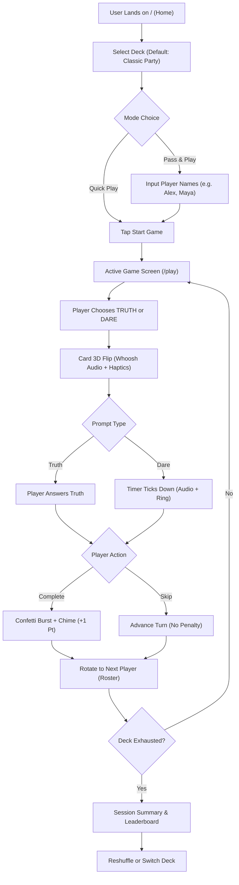

# Minimum Viable Product (MVP) Scope Specification

**Project Name:** Project Asteria  
**Document:** MVP Scope & Boundary Definition (Release Phase 5)  
**Role:** Senior Product Manager & Business Analyst  
**Date:** November 5, 2026  
**Status:** Complete — Ready for Review

---

## 1. Executive Purpose & MVP Boundary

The primary objective of the **Essential MVP (Phase 5)** is to establish a rock-solid, high-performance, single-device and local **Pass & Play party gaming experience** that decisively outperforms `truthordarequiz.com` on core game feel, visual elegance, speed, and audio feedback before introducing complex multi-device network infrastructure.

### The Golden MVP Rule:
> **Build it right, build it fast, and make every single button genuinely functional.** Zero placeholder buttons, zero unlinked mockups, and zero non-functional controls.

---

## 2. In-Scope vs. Deferred Scope Matrix

```
┌────────────────────────────────────────────────────────────────────────┐
│                        MVP BOUNDARY DEFINITION                         │
├───────────────────────────────────┬────────────────────────────────────┤
│ IN-SCOPE (ESSENTIAL MVP - PHASE 5)│ DEFERRED TO V1 & V2                │
├───────────────────────────────────┼────────────────────────────────────┤
│ • Instant Web Play (< 2s launch)  │ • Multi-Device Realtime Sync Rooms │
│ • 3D Card Flip Perspective Engine │ • Live Floating Emoji Bursts       │
│ • 5 Curated Original Decks (1000+)│ • Room Dare Consensus Voting       │
│ • Local Pass & Play Turn Roster   │ • Canvas Spinner Wheel             │
│ • Anti-Repetition Shuffle Memory  │ • Never Have I Ever Life Counter   │
│ • Integrated Dare Countdown Timer │ • Would You Rather Live % Engine   │
│ • Procedural Web Audio Synth FX   │ • Most Likely To Voting Engine     │
│ • Mobile Web Haptic Vibrations    │ • AI Question Generator (LLM)      │
│ • 18+ Age Gate & Consent Modal    │ • Programmatic SEO Landing Pages   │
│ • Universal Master Mute Toggle    │ • Community Deck Marketplace       │
│ • WCAG AA Dark/Party Theme        │ • User Accounts / OAuth Sign-In    │
└───────────────────────────────────┴────────────────────────────────────┘
```

---

## 3. Detailed MVP Screen Inventory

The MVP consists of **three core, fully functional screens**:

```
┌────────────────────────────────────────────────────────────────────────┐
│                          MVP SCREEN TOPOLOGY                           │
├────────────────────────────────────────────────────────────────────────┤
│ 1. Home / Setup Screen   ──► Deck Selector, Player Roster, Timer Setup │
│ 2. Active Game Screen    ──► Active Card, 3D Flip, Timer, Turn Counter │
│ 3. Game Over / Summary   ──► Leaderboard, Most Daring, Reshuffle / Exit│
└────────────────────────────────────────────────────────────────────────┘
```

### Screen 1: Home & Game Setup Screen (`/`)
* **Header:** Logo ("Asteria"), Mute Toggle, Settings Cog.
* **Game Setup Module:**
  * **Deck Picker:** 5 high-contrast cards:
    1. *Classic Party* (Clean, funny, universal PG-13) [Default selected].
    2. *Couples & Flirty* (Romantic intimacy, deep connection).
    3. *Teens & Hangouts* (Relatable social, school life).
    4. *Family & Kids* (Wholesome, 100% clean/school-safe).
    5. *Spicy / After Dark 18+* (Provocative adult; requires affirmative 18+ check).
  * **Player Mode Toggle:**
    * *Solo / Random Play* (Instant card draw).
    * *Pass & Play Roster* (Input 2–20 player names; add/remove chips).
  * **Timer Configuration:** Toggle Dare Timer (Disabled, 15s, 30s, 60s).
  * **Primary CTA:** Large, glowing **"START GAME"** button.

---

### Screen 2: Active Game Screen (`/play`)
* **Header / Status Bar:**
  * Active Player Pill (*"Sarah's Turn"* or *"Next Player"*).
  * Session Progress (*"Card 14 of 120"*).
  * Master Mute Toggle & Exit Session ("✕") button.
* **Central Card Container (3D Flip Architecture):**
  * **Face Down (Pre-choice):** Split card presentation with two large tactile action zones:
    * Left: **"TRUTH"** (Electric Blue gradient, question mark icon).
    * Right: **"DARE"** (Neon Flame Orange gradient, lightning icon).
  * **Face Up (Post-choice):** Card flips 180 degrees with audio whoosh, revealing:
    * Prompt Tag (e.g., *"Truth • Classic Party • Level 2"*).
    * Prompt Text in bold, legible typography.
    * Integrated Dare Timer Ring (if Dare was chosen and timer enabled).
* **Footer Controls:**
  * **"Completed (+1)"** (Triggers celebratory sound chime, confetti particle burst, and increments player score).
  * **"Skip / Veto"** (Instant penalty-free dismissal; advances turn to next player).

---

### Screen 3: Session Complete & Summary Modal
* **Trigger:** Deck exhausted OR host taps "Finish Game".
* **Components:**
  * Confetti celebration banner: *"Deck Completed!"*.
  * Session Stats: Total Cards Drawn, Truths Answered, Dares Conquered, Total Skips.
  * MVP Player Leaderboard (Sorted by completed challenges).
  * Action CTAs:
    * **"Reshuffle Deck & Play Again"** (Resets session history, keeps roster).
    * **"Choose New Deck"** (Returns to setup screen).

---

## 4. MVP Step-by-Step User Flow



---

## 5. MVP Component Breakdown (Full-Stack Dev Specifications)

To facilitate clean component design in Next.js + Tailwind CSS, the MVP will utilize the following component hierarchy:

* `components/layout/`
  * `AppHeader.tsx` (Logo, audio mute toggle, theme toggle).
  * `AppFooter.tsx` (Minimalist footer, version, rules link).
* `components/setup/`
  * `DeckSelector.tsx` (Card grid for 5 curated decks).
  * `PlayerRosterInput.tsx` (Player name input, tag chips, drag/reorder).
  * `TimerSettings.tsx` (Segmented control: Off / 15s / 30s / 60s).
  * `AgeGateModal.tsx` (18+ confirmation modal with `localStorage` persistence).
* `components/game/`
  * `GameContainer.tsx` (Zustand state subscriber, turn orchestrator).
  * `Card3D.tsx` (Perspective flip container with front/back faces).
  * `DareTimerRing.tsx` (SVG animated countdown circle with audio hook).
  * `GameControls.tsx` (Complete button, Skip button, Exit button).
  * `ConfettiCelebration.tsx` (Canvas confetti particle burst).
  * `SessionSummaryModal.tsx` (End of game stats & leaderboard).
* `lib/audio/`
  * `soundSynthesizer.ts` (Web Audio API procedural sound engine: whoosh, chime, tick, buzzer).
* `lib/game/`
  * `deckManager.ts` (Fisher-Yates shuffle with session deduplication cache).
  * `playerQueue.ts` (Roster turn rotation and score tracking).
  * `contentDatabase.ts` (Static typed repository of 1,000+ curated prompts across 5 decks).

---

## 6. MVP Exit Gate & Verification Standards

Phase 5 will not be deemed complete until:
1. All 5 decks contain at least 150 original, high-quality, verified prompts (750+ total prompts in MVP).
2. The game loop operates continuously for 100 turns with zero crashes, zero memory leaks, and zero duplicate cards.
3. Audio synthesis works across desktop Chrome, Mac Safari, iOS Safari, and Android Chrome without error.
4. Mobile haptic feedback is verified on supported mobile hardware.
5. Lighthouse score on `/` and `/play` exceeds 90 for Performance, Accessibility, and Best Practices.

