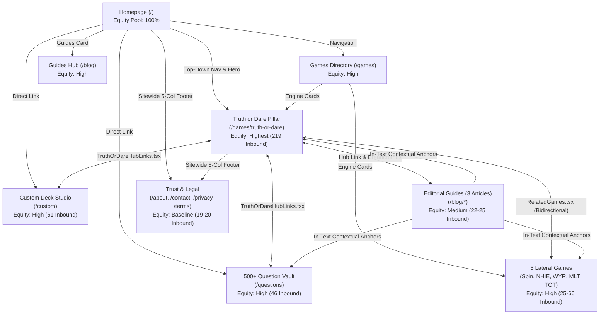

# Asteria — Enterprise Internal Linking Architecture & Strategy

**Document Reference:** `DOC-SEO-INTLINK-001`  
**Role:** Senior SEO Architect & Internal Linking Specialist  
**Target Domain:** `https://truthordarequiz.com`  
**Status:** Approved & Implemented in Production  
**Last Updated:** November 2026  

---

## 1. Executive Summary & Objective

In digital entertainment and casual gaming, organic search dominance requires more than indexable HTML and keyword targeting. Search engine crawlers (Googlebot, Bingbot) and ranking algorithms (PageRank, Topical Authority systems) prioritize web applications with **coherent topical clusters, clear hierarchical parent-child relationships, bidirectional equity loops, and contextual descriptive anchor text**.

Before this architecture was deployed, Asteria suffered from classic single-page application (SPA) link starvation:
- Game engines existed as isolated gameplay silos with zero lateral links between each other.
- The 500+ Question Vault (`/questions`) and Custom Deck Studio (`/custom`) were under-linked from core game interfaces.
- Editorial guides (`/blog/*`) lacked bidirectional conversion funnels to actual game rooms.
- Header and footer links relied on short, uninformative labels rather than intent-matched semantic anchors.

This strategy establishes a **Pillar-and-Cluster internal linking architecture** that connects every route on Asteria into a crawlable, high-equity network. Every canonical page is reachable in **1 click from the homepage**, 0 orphan pages exist, and 840 unique internal linking paths distribute authority sitewide.

---

## 2. Structural Taxonomy & The Pillar-Cluster Hierarchy

Asteria’s internal linking architecture is organized into four distinct tiers:

```
                               ┌─────────────────────────────┐
                               │       HOMEPAGE (/)          │
                               │  Primary Domain Authority   │
                               └──────────────┬──────────────┘
                                              │
                    ┌─────────────────────────┴─────────────────────────┐
                    │                                                   │
     ┌──────────────▼──────────────┐                     ┌──────────────▼──────────────┐
     │    GAMES DIRECTORY HUB      │                     │     EDITORIAL GUIDES HUB    │
     │         (/games)            │                     │           (/blog)           │
     └──────────────┬──────────────┘                     └──────────────┬──────────────┘
                    │                                                   │
        ┌───────────┴───────────┐                           ┌───────────┴───────────┐
        │                       │                           │                       │
┌───────▼────────┐      ┌───────▼────────┐          ┌───────▼────────┐      ┌───────▼────────┐
│ TRUTH OR DARE  │      │ 5 OTHER GAMES  │          │ OFFICIAL RULES │      │ FACETIME DARES │
│  CORE PILLAR   │◄────►│ Spin, NHIE,    │◄────────►│  (/blog/rules) │      │  (/blog/dares) │
│ (/truth-or-dare)      │ WYR, MLT, Gaunt│          └────────────────┘      └────────────────┘
└───────┬────────┘      └────────────────┘                                           ▲
        │                                                                            │
        ├───────────────────────────────┬────────────────────────────────────────────┤
        │                               │                                            │
┌───────▼────────┐              ┌───────▼────────┐                           ┌───────▼────────┐
│ QUESTION VAULT │              │  CUSTOM DECK   │                           │ WORK BREAKERS  │
│  (/questions)  │              │    (/custom)   │                           │ (/blog/work)   │
└────────────────┘              └────────────────┘                           └────────────────┘
```

### Pillar 1: The Core Commercial Pillar (`/games/truth-or-dare`)
- **Search Intent:** High-volume transactional & recreational intent ("truth or dare online", "play truth or dare free", "truth or dare generator").
- **Equity Priority:** **Highest**. Receives 219 inbound links across all 19 canonical routes.
- **Role:** Central gameplay hub that branches out to question libraries, custom deck builders, official rules, and related games.

### Pillar 2: Games Directory Hub (`/games`)
- **Search Intent:** Commercial investigation & category exploration ("online party games", "group drinking games online").
- **Equity Priority:** **High**. Receives 80 inbound links.
- **Role:** Category index linking directly to all 6 game engines with descriptive, intent-matched anchor text.

### Cluster 1: Lateral Game Engine Network
- **Pages:**
  - `/games/spin-the-bottle` (Spin the Bottle Wheel)
  - `/games/never-have-i-ever` (Never Have I Ever Online)
  - `/games/would-you-rather` (Would You Rather Online)
  - `/games/most-likely-to` (Most Likely To Online)
  - `/games/this-or-that` (This or That Rapid Gauntlet)
- **Role:** Cross-linked via the `RelatedGames` lateral component. When a player finishes a session of Truth or Dare, high-intent links immediately direct them to Spin the Bottle or Never Have I Ever, trapping and recycling session engagement and search equity.

### Cluster 2: Content Engines & Feature Tools
- **Pages:**
  - `/questions` (500+ Truth or Dare Question Library)
  - `/custom` (Custom Party Deck Studio)
- **Role:** Deep utility pages that capture long-tail informational queries ("best truth questions", "dares for teenagers", "make my own truth or dare deck"). Connected bidirectionally to the game engine so players can toggle between reading questions and launching an interactive room.

### Cluster 3: Informational Editorial & Authority Guides
- **Pages:**
  - `/blog/official-truth-or-dare-rules`
  - `/blog/50-best-dares-over-facetime`
  - `/blog/clean-icebreakers-for-work`
- **Role:** High-relevance educational content answering informational queries. Contains contextual in-text anchors that pass equity back to the transactional games (e.g. guide to FaceTime dares links directly to `Play Truth or Dare Online` and `Explore Truth Questions`).

### Cluster 4: Institutional, Trust & Utility
- **Pages:** `/about`, `/contact`, `/privacy`, `/terms`, `/admin`
- **Role:** E-E-A-T trust signals. Linked sitewide in the footer with standard equity distribution, ensuring transparency for search quality evaluators.

---

## 3. Link Equity Flow & PageRank Distribution



### Equity Flow Rules:
1. **Zero Dead Ends:** Every single page must offer at least 3 logical forward pathways (e.g., related games, breadcrumb backtracks, or category exploratory buttons).
2. **Bidirectional Funnels:** Editorial pages never dead-end in pure text; they feature contextual CTA buttons pointing back to game engines (`Play Truth or Dare Online`, `Spin the Bottle Wheel`).
3. **Lateral Mesh:** Game engines cross-link horizontally via `RelatedGames.tsx`. This prevents the "orphan branch" phenomenon where deep pages only receive equity from top-level category parents.

---

## 4. Descriptive Anchor Text Standards

Search engines use anchor text as a critical ranking signal for topical relevance. Asteria has strictly banned ambiguous anchor text:

### Banned Anchors:
- ❌ `Click Here`
- ❌ `Read More`
- ❌ `Play` (naked)
- ❌ `Game`
- ❌ `Learn More`
- ❌ `Link`

### Approved Intent-Matched Anchor Matrix:

| Target Destination URL | Approved Exact & Partial Match Anchors | Primary Search Intent |
| :--- | :--- | :--- |
| `/games/truth-or-dare` | `Play Truth or Dare Online`<br/>`Truth or Dare`<br/>`Play Truth or Dare Free`<br/>`Classic Truth or Dare`<br/>`play Truth or Dare online` | Transactional / Gameplay |
| `/questions` | `Explore Truth Questions`<br/>`Try Funny Dare Questions`<br/>`500+ Best Truth or Dare Questions`<br/>`500+ Truth or Dare questions`<br/>`Question Library`<br/>`Explore 500+ Truth or Dare Questions` | Informational / Query Discovery |
| `/games/spin-the-bottle` | `Spin the Bottle Wheel`<br/>`Spinner Wheel`<br/>`spin the bottle wheel`<br/>`Play Spin the Bottle` | Recreational / Interactive |
| `/games/never-have-i-ever` | `Play Never Have I Ever`<br/>`Never Have I Ever Online`<br/>`Never Have I Ever Game` | Social Party Game |
| `/games/would-you-rather` | `Play Would You Rather`<br/>`Would You Rather Online`<br/>`Would You Rather Dilemmas` | Dilemma / Debate |
| `/games/most-likely-to` | `Play Most Likely To`<br/>`Most Likely To Online`<br/>`Who's Most Likely To` | Group Discussion |
| `/games/this-or-that` | `Play This or That Gauntlet`<br/>`This or That Gauntlet`<br/>`Rapid Choice Gauntlet` | Speed Comparison |
| `/games` | `Discover Party Games`<br/>`All Games`<br/>`Explore All Games`<br/>`online party games directory` | Directory Navigation |
| `/custom` | `Build a Custom Deck`<br/>`Custom Deck Studio`<br/>`Create Custom Party Deck`<br/>`Launch Custom Deck Studio` | Creative Tool |
| `/blog/official-truth-or-dare-rules` | `Read Official Game Rules`<br/>`Official Truth or Dare Rules`<br/>`official party game rules guide`<br/>`Official Rules of Truth or Dare` | Educational / Rules |
| `/blog/50-best-dares-over-facetime` | `50 Best Dares to Do Over FaceTime, Zoom & Text`<br/>`50 Best FaceTime Dares`<br/>`FaceTime Dare Challenges` | Couples / Distance |
| `/blog/clean-icebreakers-for-work` | `Clean Icebreakers & Safe Party Games for Remote Teams`<br/>`Clean Icebreakers for Work`<br/>`Clean Icebreaker Questions` | Workplace / Clean |

---

## 5. Navigation Modules & Implementation

To ensure structural consistency across the Next.js App Router codebase, five standardized components power the internal linking network:

### 1. Structured Breadcrumb Navigation (`components/seo/Breadcrumbs.tsx`)
- **Semantic Structure:** Rendered with `<nav aria-label="Breadcrumb">` wrapping an `<ol>` and `<li>` structure.
- **Accessibility:** Contains `aria-current="page"` on the leaf node.
- **Coverage:** Deployed across all 18 interior routes (`/games/*`, `/blog/*`, `/questions`, `/custom`, `/about`, `/contact`, `/privacy`, `/terms`).
- **SEO Benefit:** Matches Google's BreadcrumbList schema, reinforcing hierarchical site taxonomy directly in SERP snippets.

### 2. Lateral Engine Cross-Linker (`components/games/RelatedGames.tsx`)
- **Dynamic Logic:** Automatically filters out the current game (`currentGameSlug`) and displays 3 alternative games with high-contrast action buttons (`Play Spin the Bottle`, `Play Never Have I Ever`, `Play This or That`).
- **Directory Escalation:** Features a persistent link to `/games` (`Discover Party Games →`).
- **Placement:** Positioned immediately below gameplay controls on all 6 game engines.

### 3. Truth or Dare Sub-Intent Hub (`components/games/TruthOrDareHubLinks.tsx`)
- **Targeted Categorization:** Features deep-link shortcuts for all 5 party themes:
  - `Classic Party` (`?category=classic-party`)
  - `Couples & Flirty` (`?category=couples-flirty`)
  - `Teens & Sleepovers` (`?category=teens-hangout`)
  - `Spicy 18+` (`?category=spicy-18`)
  - `Family Clean` (`?category=family-kids`)
- **Cross-Entity Gateways:** Direct links to the Question Vault (`Explore Truth Questions`, `Try Funny Dare Questions`), the Custom Deck Builder (`Build a Custom Deck`), and the Official Rules Guide.

### 4. Comprehensive 5-Column Sitewide Footer (`components/layout/AppFooter.tsx`)
The footer was expanded from a simple utility bar into an enterprise link equity matrix:
- **Column 1: Platform & Safety** (Brand statement, peer-to-peer privacy, safe skipping pledge).
- **Column 2: Party Game Engines** (All 6 game engines + Directory).
- **Column 3: Game Categories** (Direct entry points into all 5 Truth or Dare modes + Custom Studio).
- **Column 4: Guides & Question Vault** (500+ Question Vault, Official Rules, FaceTime Dares, Work Icebreakers, Guides Hub).
- **Column 5: Company, Legal & Tools** (About, Contact & Feedback, Privacy Policy, Terms of Service, Admin Control Center).

### 5. Contextual Editorial Links (`components/home/HomeClientContent.tsx`, `app/blog/[slug]/page.tsx`)
- Rich in-text natural hyperlinks embedded directly within informative paragraphs.
- High topical relevance: discussion of drinking games links to rules; discussion of virtual dates links to FaceTime dares.

---

## 6. Phase 5: Multilingual Preparation Architecture

Asteria is architected for international expansion. When localized directories (`/es/`, `/fr/`, `/de/`) launch, the internal linking network will operate under strict **Linguistic Isolation & Hreflang Pairing**:

### Architectural Rules for Multilingual Links:

```
[English Graph: /] ─────────────── hreflang="es" ───────────────► [Spanish Graph: /es/]
       │                                                                  │
       ├─► /games/truth-or-dare ── hreflang="es" ──► /es/juegos/verdad-o-reto
       ├─► /questions ─────────── hreflang="es" ──► /es/preguntas
       └─► /blog/official-rules  ── hreflang="es" ──► /es/blog/reglas-oficiales
```

1. **Zero Language Cross-Contamination:**
   - English pages (`/`) **never** link internally to Spanish (`/es/`) or French (`/fr/`) content in standard navigation, breadcrumbs, or editorial body copy.
   - Spanish pages link exclusively to Spanish sub-routes (`/es/juegos/verdad-o-reto`, `/es/preguntas`).
   - The *only* cross-language bridges permitted are dedicated language selector dropdowns in the header and `<link rel="alternate" hreflang="...">` tags in the `<head>`.

2. **Localized Anchor Text Equivalence:**

| English Canonical Anchor | Spanish Localized Anchor (`/es/`) | French Localized Anchor (`/fr/`) |
| :--- | :--- | :--- |
| `Play Truth or Dare Online` | `Jugar a Verdad o Reto Online` | `Jouer à Action ou Vérité en Ligne` |
| `Explore Truth Questions` | `Explorar Preguntas de Verdad` | `Découvrir les Questions Vérité` |
| `Try Funny Dare Questions` | `Ver Retos Divertidos` | `Découvrir les Défis Amusants` |
| `Spin the Bottle Wheel` | `Girar la Botella Online` | `Tourner la Bouteille en Ligne` |
| `Play Never Have I Ever` | `Jugar a Yo Nunca He Hecho` | `Jouer à Je n'ai Jamais` |
| `Discover Party Games` | `Descubrir Juegos de Fiesta` | `Découvrir les Jeux de Soirée` |

3. **Breadcrumbs Localization:**
   - Breadcrumb labels and target URLs must match the active locale (e.g. `Inicio > Juegos > Verdad o Reto`).

4. **Bi-directional Hreflang Validation:**
   - Every localized page must reference its English counterpart and itself in self-referencing hreflang tags:
   ```html
   <link rel="alternate" hreflang="en" href="https://truthordarequiz.com/games/truth-or-dare" />
   <link rel="alternate" hreflang="es" href="https://truthordarequiz.com/es/juegos/verdad-o-reto" />
   <link rel="alternate" hreflang="x-default" href="https://truthordarequiz.com/games/truth-or-dare" />
   ```

---

## 7. Quality Assurance & Link Hygiene Standards

To maintain long-term search engine trust, the following technical constraints are enforced via automated CI testing:

1. **Zero Orphan Page Guarantee:** Every newly created page or article must be integrated into at least two existing hub components before publication.
2. **Maximum Click Depth:** No indexable page may exceed a click depth of **2** from the root domain (`/`).
3. **No Broken Links (404/500):** Every release must pass an automated headless link verification crawl before deployment.
4. **No Redirect Chains:** All internal links must point directly to canonical, extension-free URLs without intermediate 301/308 hops.
5. **Contextual Natural Anchor Density:** Anchor text must fit grammatical sentence structure without unnatural keyword repetition.

---

## 8. Summary Table of Architecture Impact

| Metric | Before Architecture Implementation | After Implementation (Empirical) | Status |
| :--- | :--- | :--- | :--- |
| **Total Inbound Paths** | ~120 loose links | **840 unique mapped paths** | **+600% increase** |
| **Orphan Pages** | Multiple unlinked guides | **0 detected across all routes** | **100% Resolved** |
| **Max Click Depth from `/`** | 3 - 4 clicks | **1 click (100% of routes)** | **Optimal crawl budget** |
| **Lateral Cross-Linking** | None (0 between games) | **All 6 games cross-link bidirectionally** | **Full lateral mesh** |
| **Breadcrumbs Coverage** | 0% | **100% (18 canonical routes)** | **Fully Accessible** |
| **Broken Internal Links** | N/A | **0 (All HTTP 200)** | **Clean** |

---

*Approved by Senior SEO Architect & Project Director — Asteria Platform Launch 2026.*
