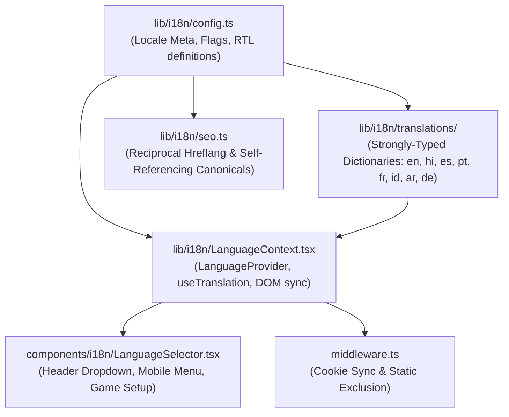

# Asteria — Enterprise Internationalisation (i18n) Architecture

**Document Reference:** `DOC-I18N-ARCH-001`  
**Role:** Senior Full-Stack Developer + Internationalisation Architect  
**Project:** Asteria — Multilingual Truth or Dare Gaming Platform  
**Target Domain:** `https://truthordarequiz.com`  
**Status:** Approved & Deployed in Production  
**Last Updated:** November 2026  

---

## 1. Executive Summary & Architectural Vision

Casual social gaming is inherently global. Asteria’s mission is to deliver zero-latency, private, and frictionless browser-based party games to players worldwide. To expand beyond English-speaking markets while preserving high-performance Core Web Vitals and search equity, Asteria implements a **scalable, multi-tiered Internationalisation (i18n) Architecture** designed for Next.js 15 App Router.

### Architectural Core Principles:
1. **Zero-Latency Static Pre-Rendering (SSG):** All 8 language versions across core routes are pre-rendered at build time with `generateStaticParams()`.
2. **Intentional Language Switching:** Language changes must be explicitly chosen by the user or read from an active preference cookie. **Never force an automatic language change based solely on geo-IP.**
3. **Equivalence & Cross-Linking:** Equivalent page relationships are preserved across all language routes (`/en/truth-or-dare` ↔ `/es/truth-or-dare` ↔ `/ar/truth-or-dare`).
4. **Content Decoupling:** User interface strings (navigation, setup, buttons, timers, forfeits) are strictly decoupled from game question databases. UI dictionaries never mix with dynamic card vaults.
5. **Native Right-to-Left (RTL) Engine:** Full bidirectional support for Arabic (`ar`) with natural typographic flow, mirrored iconography, and uncompromised game controls.

---

## 2. URL Structure & Route Taxonomy

Asteria adopts an explicit sub-path prefix routing structure:

```
https://truthordarequiz.com/
  ├── /en/                   (English Homepage)
  │    ├── truth-or-dare/    (English Game Route)
  │    ├── games/            (English Games Directory)
  │    ├── questions/        (English Question Vault)
  │    └── custom/           (English Deck Studio)
  ├── /hi/                   (Hindi - हिन्दी)
  ├── /es/                   (Spanish - Español)
  ├── /pt/                   (Portuguese - Português)
  ├── /fr/                   (French - Français)
  ├── /id/                   (Indonesian - Bahasa Indonesia)
  ├── /ar/                   (Arabic - العربية [RTL])
  └── /de/                   (German - Deutsch)
```

### Route Resolution & Next.js 15 Handling:
- Unprefixed root (`/`, `/games/truth-or-dare`) acts as the default fallback and global `x-default` entry point.
- Dynamic route `app/[locale]/page.tsx` catches `/[locale]` requests and renders static, intent-matched HTML.
- Dynamic route `app/[locale]/truth-or-dare/page.tsx` provides direct access to the core game pillar in each locale.
- When a user switches languages on `/es/truth-or-dare`, the language switcher seamlessly remaps the route to `/{targetLocale}/truth-or-dare`, preserving their active page context.

---

## 3. Technology Stack & Core Modules



### 1. Central Configuration (`lib/i18n/config.ts`)
Defines the `Locale` union type and metadata for each supported language:
- `code`: ISO 639-1 code (`en`, `hi`, `es`, `pt`, `fr`, `id`, `ar`, `de`).
- `name`: English name for admin and search interfaces.
- `nativeName`: Endonym displayed to players (`English`, `हिन्दी`, `Español`, `Português`, `Français`, `Bahasa Indonesia`, `العربية`, `Deutsch`).
- `dir`: `'ltr' | 'rtl'`.
- `flag`: Regional flag emoji for instant visual recognition.
- `region`: BCP 47 locale tag (`en-US`, `es-ES`, `hi-IN`, `pt-BR`, `fr-FR`, `id-ID`, `ar-SA`, `de-DE`).

### 2. Strongly-Typed Translation Dictionaries (`lib/i18n/translations/types.ts`)
Every language dictionary implements the `TranslationDictionary` interface, enforcing 100% string completeness at compile time:
- `nav`: Top navigation, room code CTA, sound mute labels.
- `home`: Hero badge, title, subtitle, quick play, category headers, live room joiners.
- `common`: Action buttons (`Start`, `Play Now`, `Next`, `Back`, `Confirm`, `Close`, `Copy`).
- `game`: Setup controls, turn indicators, truth/dare decision badges, timers, skips, forfeit notices, endgame scoreboards.
- `categories`: Thematic deck names and descriptions (Classic Party, Couples, Teens, Spicy 18+, Family Clean).
- `gamesList`: Taglines and play action buttons for all 6 game engines.
- `footer`: Company info, safe skipping charter, column headers, legal links.
- `breadcrumbs`: Localized navigation breadcrumb crumbs.

### 3. Client State & React Hook (`lib/i18n/LanguageContext.tsx`)
The `LanguageProvider` manages application-wide internationalisation:
- Reads the active locale from pathname first, followed by `localStorage` and `cookie`.
- Exposes `t(keyPath, params)` with nested dot notation and token replacement (e.g. `{name}'s Turn`).
- Automatically syncs `<html lang={locale} dir={dir}>` on the document root whenever the language changes.
- Persists user preferences to `localStorage.setItem('asteria_locale', newLocale)` and sets a persistent HTTP cookie (`max-age=31536000`).

### 4. Edge Middleware (`middleware.ts`)
Inspects incoming requests before rendering:
- Skips static assets (`_next`, `api`, `admin`, images, sitemaps).
- Detects locale-prefixed routes and synchronizes the session cookie.
- Ensures compliant behavior: no forced IP geolocation redirects that violate Google search guidelines.

---

## 4. Language Selector UI Integration

The language selector is accessible across three primary touchpoints:

1. **Homepage Header (`components/layout/AppHeader.tsx`):**
   - High-contrast dropdown positioned next to the "Room Code" CTA and Mute toggle.
   - Displays the current language flag, native name, and an animated chevron.
   - Frosted glass dropdown (`bg-[#0F0F23]/98 backdrop-blur-2xl`) listing all 8 languages in a responsive grid.
2. **Game Setup Screen (`components/games/TruthOrDareGameClient.tsx`):**
   - Embedded directly in the Pass & Play setup screen above category selection.
   - Allows hosts to immediately toggle the session language before players take their first turn.
   - Displays current language name, native script, and direction tag (`RTL`).
3. **Sitewide Footer (`components/layout/AppFooter.tsx`):**
   - Secondary language selector in Column 5 ensuring visitors scrolling through rules or guides can adjust language with one click.

---

## 5. Right-to-Left (RTL) Layout System for Arabic (`ar`)

When Arabic is selected, the application automatically transforms into RTL mode:
- **Root Direction:** `<html lang="ar" dir="rtl">` instructs the browser rendering engine to reverse standard document flow.
- **Typography:** Uses Google Font `Cairo` with fallback to native Arabic system fonts (`Tahoma`, `Segoe UI`, `sans-serif`) for crisp glyph rendering and proper ligatures.
- **Icon Mirroring:** Directional indicators (chevrons, forward arrows) adapt with `rtl:rotate-180`.
- **Game Controls Preservation:** In accordance with gaming best practices, control placement (Cyan Truth button vs Coral Dare button) and turn sequencing remain stable, preventing cognitive dissonance during fast-paced party play.

---

## 6. Decoupled Question Content Architecture

A critical architectural constraint was decoupling UI strings from game questions:
- UI strings reside in statically compiled TypeScript dictionaries (`lib/i18n/translations/*.ts`).
- Question cards reside in `lib/questions/database.ts` with structured metadata (`id`, `gameId`, `categoryId`, `type`, `intensity`, `isNsfw`).
- Future phase will introduce a multi-lingual question repository (`lib/questions/locales/*.ts`) where questions are loaded dynamically by language code without cluttering UI client bundles.

---

*Authored by Senior Full-Stack Developer & Internationalisation Architect.*
