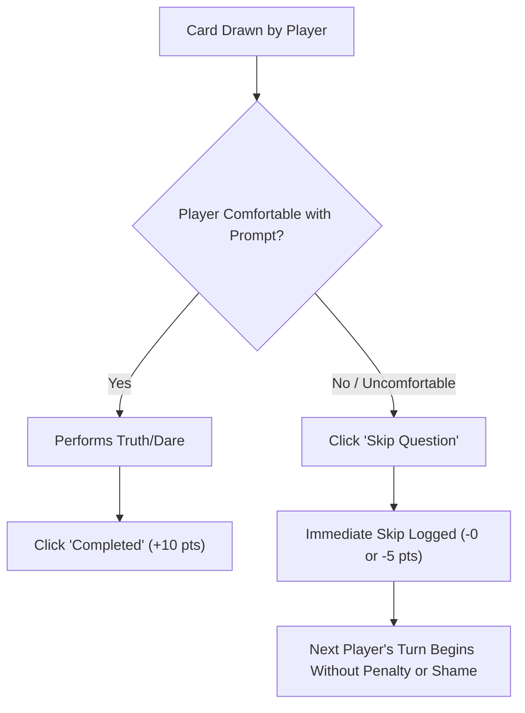

# Asteria Content Safety & Player Well-Being Guidelines

**Document**: Global Content Safety, Moderation & Ethics Protocol  
**Platform**: Asteria Gaming Platform  
**Compliance**: COPPA, GDPR, Global Online Safety Standards  
**Date**: November 2026  

---

## 1. Core Safety Mission

Party games must be funny, memorable, and thrilling without compromising physical safety, psychological well-being, or human dignity. Asteria enforces an unconditional commitment to **Safe Play, Enthusiastic Consent, and Zero Harm**.

---

## 2. Absolute Content Exclusions (Zero-Tolerance List)

Any prompt submitted, authored, or proposed containing any of the following elements is strictly disqualified and permanently blocked:

### 2.1 Physical Danger & Self-Harm
- ❌ No consumption of non-food items, excessive alcohol, or dangerous substances.
- ❌ No challenges involving fire, heights, moving vehicles, sharp objects, or balance hazards.
- ❌ No actions requiring physical distress (choking, suffocation, breath-holding).

### 2.2 Illegal Acts & Property Damage
- ❌ No shoplifting, trespassing, vandalism, or property destruction.
- ❌ No unauthorized prank calls to emergency services (police, fire, healthcare).
- ❌ No financial fraud or unauthorized credit card transactions.

### 2.3 Non-Consensual Interaction & Harassment
- ❌ No unsolicited physical contact, non-consensual kissing, or touch.
- ❌ No non-consensual messaging to strangers, ex-partners, or employers.
- ❌ No recording or photographing players without explicit upfront consent.
- ❌ No public humiliation of service workers, waitstaff, or bystanders.

### 2.4 Bullying, Discrimination & Hate Speech
- ❌ No derogatory remarks based on race, ethnicity, religion, sexual orientation, disability, or gender identity.
- ❌ No body-shaming, fat-shaming, or mockery of physical appearances.
- ❌ No weaponized secrets intended to damage a player's real-world relationships.

---

## 3. The Consent & Player Autonomy Architecture

Asteria embeds safety directly into the user interface and game engine:

### 3.1 The Unconditional Skip Rule
- Any player may click **"Skip Question"** at any moment for any reason.
- The UI treats skips respectfully without taunts, flashing sirens, or punitive messaging.

### 3.2 Age Gating for Mature (R-18) Content
- Any category containing `R-18` rated content (e.g. `spicy-18`, adult couples) triggers the `AgeGateModal`.
- Requires active player affirmation of being 18 years of age or older.
- Age verification token is stored locally (`localStorage: asteria_age_verified = 'true'`).
- `QuestionEngine` features an `isFamilySafe: boolean` filter that completely strips all `R-18` questions from the active deck when family mode is active.

---

## 4. Multilingual & Cross-Cultural Moderation Standards

1. **Devanagari Hindi**: Screened to prevent casteist slurs, communal microaggressions, or inappropriate family insults.
2. **Arabic**: Screened to respect cultural and familial modesty standards while maintaining lighthearted youth humor.
3. **Indonesian**: Screened for local SARA (Suku, Agama, Ras, dan Antargolongan) sensitivity.
4. **European Languages (Spanish, Portuguese, French, German)**: Reviewed by native linguistic guidelines to ensure idiomatic appropriateness.

---

## 5. Administrative Moderation & Rapid Response

Through `/admin/`, administrators can:
1. Filter questions by language and category.
2. Toggle `is_active: false` on any question with a single click, instantly removing it from live gameplay pools across all servers.
3. Review audit timestamps and verify safety clearance flags (`safety_reviewed: true`).

