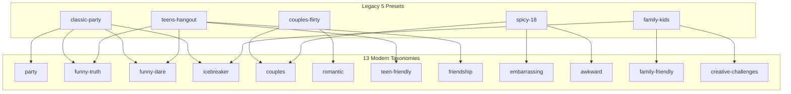

# Asteria Question Category Architecture & Mapping

**Document**: Category Architecture & Legacy Compatibility Map  
**File Reference**: `lib/questions/database/categories.ts` & `lib/questions/engine.ts`  
**Date**: November 2026  

---

## 1. The 13 Core Question Categories

Asteria categorizes all gameplay prompts into 13 standardized taxonomies, ensuring balanced variety across all party dynamics:

| Category ID | Display Name | Icon | Default Rating | Target Age Group | Primary Emotional Tone |
|:---|:---|:---:|:---:|:---:|:---|
| `funny-truth` | Funny Truth | 😂 | `PG-13` | `all-ages` | Amusing everyday quirks, embarrassing stories, ridiculous habits |
| `funny-dare` | Funny Dare | 🎭 | `PG-13` | `all-ages` | Silly physical antics, impressions, accents, catwalks |
| `friendship` | Friendship | 🤝 | `PG-13` | `teens` / `all-ages` | Loyalty, mutual memories, trust, friendly hypotheticals |
| `couples` | Couples | 💑 | `PG-13` / `R-18` | `adults` | Relationship dynamics, pet peeves, sweet milestones, romantic secrets |
| `romantic` | Romantic | 💖 | `PG-13` | `adults` / `teens` | Flirty banter, crushes, compliments, movie-like confessions |
| `awkward` | Awkward | 😬 | `PG-13` | `all-ages` | Social faux pas, cringe encounters, mistaken identities |
| `embarrassing` | Embarrassing | 🙈 | `PG-13` | `all-ages` | Epic fails, fashion disasters, middle school phases |
| `personal` | Personal | 🤔 | `PG-13` | `all-ages` | Core values, hidden aspirations, life lessons, deep reflections |
| `family-friendly` | Family Friendly | 👨‍👩‍👧‍👦 | `G` | `all-ages` / `kids` | 100% wholesome, safe for parents, younger siblings, and kids |
| `party` | Party | 🥳 | `PG-13` | `all-ages` | Group energy boosters, rapid-fire voting, high-tempo engagement |
| `teen-friendly` | Teen Friendly | 🎒 | `PG-13` | `teens` | School drama, popular culture, peer dynamics, trending memes |
| `icebreaker` | Icebreaker | 🧊 | `G` | `all-ages` | Zero-risk introductory prompts for people meeting for the first time |
| `creative-challenges` | Creative Challenges | 🎨 | `PG-13` | `all-ages` | Rhyming, mime, storytelling, acting, improvisation |

---

## 2. Legacy Category Preset Bridge

To ensure that pre-existing game bookmarks, external referral links, and SEO landing pages (such as `?category=classic-party` or `?category=spicy-18`) continue to operate without broken links, Asteria provides an automated bidirectional mapping bridge via `LEGACY_CATEGORY_MAP`:



### Mapping Definitions in Code

```typescript
export const LEGACY_CATEGORY_MAP: Record<LegacyCategoryId, QuestionCategory[]> = {
  'classic-party': ['party', 'funny-truth', 'funny-dare', 'icebreaker'],
  'couples-flirty': ['couples', 'romantic'],
  'teens-hangout': ['teen-friendly', 'friendship', 'funny-truth', 'funny-dare'],
  'spicy-18': ['couples', 'embarrassing', 'awkward'],
  'family-kids': ['family-friendly', 'icebreaker', 'creative-challenges'],
};
```

---

## 3. Filtering Engine Logic (`lib/questions/engine.ts`)

When a user initiates gameplay with a `categoryId`:
1. If `categoryId` matches a legacy key (e.g. `'classic-party'`), the engine queries all questions belonging to `['party', 'funny-truth', 'funny-dare', 'icebreaker']` plus questions with `categoryId === 'classic-party'`.
2. If `categoryId` is one of the 13 standardized categories (e.g. `'funny-truth'`), it queries all questions where `q.category === categoryId`.
3. If no questions match for the requested language and category combination:
   - The engine returns `card: null` and `isExhausted: true`.
   - **Crucial Rule**: The engine never silently falls back to English cards when a non-English language is chosen.
   - The UI surfaces a clear notice: *"No questions currently available in this category for {LANGUAGE}. Please choose another category."*

