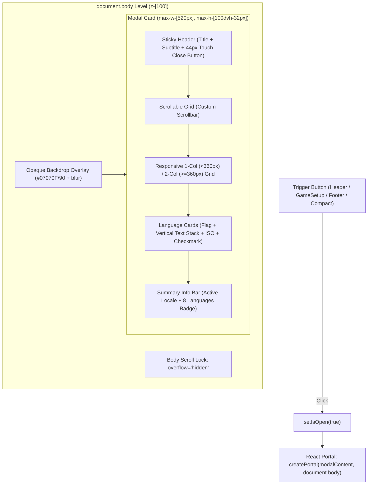

# Language Modal Implementation & Architecture Fixes

**Project:** Asteria — Multilingual Truth or Dare Gaming Platform  
**Component:** `components/i18n/LanguageModal.tsx` & `components/i18n/LanguageSelector.tsx`  
**Engineer:** Senior Frontend Developer + Mobile UI/UX Engineer  
**Date:** November 2026  

---

## 1. Architectural Architecture Overview

To eliminate all viewport clipping, z-index collisions, and background bleed-through, the language selection system was re-architected from a localized relative dropdown into a high-performance **Full-Viewport Modal Portal**.



---

## 2. Core Implementation Details

### A. React Portal Isolation & SSR Safety
Instead of nesting the modal DOM inside `<header className="... overflow-hidden">`, `LanguageModal` mounts directly to `document.body` via `createPortal`:
```tsx
export function LanguageModal({ isOpen, onClose }: LanguageModalProps) {
  const [mounted, setMounted] = useState(false);

  useEffect(() => {
    setMounted(true);
  }, []);

  if (!isOpen || !mounted) return null;

  return createPortal(modalContent, document.body);
}
```
* **Benefits:** Decouples the modal completely from parent overflow clipping, transform coordinates, and header stacking context.

### B. High-Opacity Full-Viewport Backdrop
To eliminate background text bleed-through, an opaque backdrop spans the entire viewport:
```tsx
<div
  role="dialog"
  aria-modal="true"
  aria-labelledby="language-modal-title"
  aria-describedby="language-modal-description"
  className="fixed inset-0 z-[100] flex items-center justify-center p-3 sm:p-4 md:p-6 bg-[#07070F]/90 backdrop-blur-md pt-[max(0.75rem,env(safe-area-inset-top))] pb-[max(0.75rem,env(safe-area-inset-bottom))] transition-all animate-in fade-in duration-200"
  onClick={(e) => {
    if (e.target === e.currentTarget) onClose();
  }}
>
```
* **Backdrop Color:** `#07070F` at 90% opacity with `backdrop-blur-md` guarantees 100% legibility of modal contents while softly muting the background.
* **Safe-Area Insets:** Dynamic `env(safe-area-inset-top)` and `env(safe-area-inset-bottom)` prevent overlap with the mobile notch or home indicator.

### C. Body Scroll Locking with State Restoration
When the modal opens, page scrolling is locked and touch action is paused:
```tsx
useEffect(() => {
  if (!isOpen) return;

  const originalOverflow = document.body.style.overflow;
  const originalTouchAction = document.body.style.touchAction;

  document.body.style.overflow = 'hidden';
  document.body.style.touchAction = 'none';

  return () => {
    document.body.style.overflow = originalOverflow;
    document.body.style.touchAction = originalTouchAction;
  };
}, [isOpen]);
```

### D. Keyboard & Event Management
* **Escape Key:** Pressing Escape triggers `onClose()`.
* **Click Outside:** Direct clicks on the backdrop dismiss the modal.
* **Click Inside:** `e.stopPropagation()` on the modal dialog card prevents unintentional closure.

### E. Responsive Dimensions & Geometry
* **Mobile Dimensions:**
  - `w-full max-w-[520px]`
  - `max-h-[calc(100dvh-32px)] sm:max-h-[85vh]`
  - On 320px devices: width is exactly 296px (`320px - 24px` margin), centered with 12px margin on both sides.
  - On 360px devices: width is 336px, centered with 12px margin.
  - On >= 520px devices: clamped at 520px max width.

### F. Sticky Header & Touch Target
* **Header:** `sticky top-0 z-10 px-4 sm:px-6 py-3.5 sm:py-4 bg-[#0F0F23]/98 backdrop-blur-xl border-b border-white/10`
* **Close Button:** `w-10 h-10` with accessible label `aria-label={t('common.close')}` meeting mobile touch-target guidelines.
* **Subtitle:** Displays `common.languageSubtitle` in all 8 languages:
  - English: *"Select your preferred interface and question language"*
  - Hindi: *"अपनी पसंदीदा भाषा और गेम प्रश्न चुनें"*
  - Spanish: *"Selecciona tu idioma preferido para la interfaz y preguntas"*
  - Portuguese: *"Selecione seu idioma preferido para o jogo e perguntas"*
  - French: *"Choisissez votre langue pour l'interface et les questions"*
  - Indonesian: *"Pilih bahasa antarmuka dan pertanyaan permainan Anda"*
  - Arabic: *"اختر لغتك المفضلة للواجهة وأسئلة اللعبة"*
  - German: *"Wähle deine bevorzugte Sprache für Menüs und Fragen"*

### G. Responsive Grid & Vertical Typography Hierarchy
In `tailwind.config.js`, the `xs: '360px'` breakpoint was added to extend standard Tailwind screens:
```tsx
<div className="grid grid-cols-1 xs:grid-cols-2 gap-2 sm:gap-2.5">
```
* **Below 360px (Ultra-Compact):** Renders **1 column** where each card has the full width (~272px), providing generous room for flag, names, and checkmark.
* **360px and Above:** Renders **2 columns** with spacious card margins.

#### Stacking Typography (Zero Collisions):
```tsx
<div className="flex flex-col min-w-0 truncate">
  <span className="text-xs sm:text-sm font-bold tracking-tight text-white truncate leading-tight">
    {item.name}
  </span>
  <span className="text-[11px] sm:text-xs font-semibold text-brand-300 truncate leading-tight mt-0.5">
    {item.nativeName}
  </span>
  <div className="flex items-center gap-1.5 mt-1">
    <span className="text-[9px] font-mono uppercase tracking-wider font-semibold text-slate-400">
      {item.code}
    </span>
    {item.dir === 'rtl' && (
      <span className="text-[8px] font-semibold uppercase px-1 py-0.2 rounded bg-brand-500/30 text-brand-200 border border-brand-400/20">
        RTL
      </span>
    )}
  </div>
</div>
```
* English name on top in bold white text.
* Native name below in `text-brand-300` purple accent.
* Devanagari Hindi (`हिन्दी`) uses generous line height and margin, preventing clipping of vowels/matras.
* Arabic (`العربية`) displays correctly with `RTL` badge indicator.

---

## 3. Preserved Brand & Game Integration
1. **Brand Aesthetics:** Dark gaming theme with `#07070F` base, `#0F0F23` surface, `#8B5CF6` purple glow, and crisp borders (`border-white/15`).
2. **Multiple Triggers:** Seamlessly triggers from:
   - Header trigger button (`variant="header"`)
   - Compact button (`variant="compact"`)
   - Game setup view (`variant="gameSetup"`)
   - Footer trigger (`variant="footer"`)
3. **Seamless State Transition:**
   - Clicking any language instantly updates `LanguageContext`.
   - Persists selection to `localStorage` and `asteria_locale` cookie (365 days).
   - Transitions to the corresponding localized subpath (`/hi`, `/es`, `/ar`, etc.).
   - Dynamically updates `<html lang="...">` and `<html dir="...">`.
   - Closes the modal with haptic feedback without resetting ongoing game state.
