# Progressive Web App (PWA) Architecture Specification
**Platform:** Asteria Party Gaming Platform (`https://truthordarequiz.com`)  
**Specification Version:** 1.0.0  
**Framework:** Next.js 15.5.29 App Router / React 19  

---

## 1. Executive Summary

Asteria's Progressive Web App (PWA) implementation transforms the browser-based party gaming platform into an installable, lightning-fast, and resilient app capable of local pass-and-play operation even in poor or nonexistent network conditions.

The architecture balances two critical requirements:
1. **Zero-Friction Offline Access for Local Gameplay:** Core application shells, static visual assets, and local questions remain instantly accessible offline.
2. **Strict Security & Real-Time Privacy Isolation:** Live multiplayer room synchronization, socket/polling connections, and administrative management endpoints are strictly barred from service worker cache storage, preventing stale game state and credential persistence.

```
                              +---------------------------------------+
                              |         Browser Client / Tab          |
                              +---------------------------------------+
                                                  |
                                                  v
                              +---------------------------------------+
                              |   Asteria Service Worker (/sw.js)     |
                              |              Scope: "/"               |
                              +---------------------------------------+
                                    /             |             \
                                   /              |              \
             [Security Bypass]    /      [Static Assets]   [Navigation / API]
                                 v                v              v
                 +-------------------+  +------------------+  +-------------------+
                 | Strict Network-   |  | Stale-While-     |  | Network-First     |
                 | Only Strategy     |  | Revalidate       |  | Cache Fallback    |
                 |                   |  |                  |  |                   |
                 | - /api/admin/*    |  | - /_next/static  |  | - Navigations (/) |
                 | - /api/rooms/*    |  | - /icons/*.png   |  | - /api/questions  |
                 | - /admin/*        |  | - Google Fonts   |  | Fallback: /offline|
                 +-------------------+  +------------------+  +-------------------+
```

---

## 2. Core Architectural Pillars

### 2.1 Single Canonical Service Worker
To prevent conflicting cache stores, duplicate worker registrations, or rogue proxying, Asteria registers a single canonical service worker located at `/sw.js` with root scope (`/`).
- **Registration Controller:** `components/pwa/PWARegistration.tsx` checks `navigator.serviceWorker.getRegistrations()` before registering, eliminating redundant threads.
- **Immediate Client Takeover:** During `install`, `self.skipWaiting()` forces the active state; during `activate`, `self.clients.claim()` ensures all open browsing contexts immediately pipe network requests through the latest caching rules.

### 2.2 Next.js App Router Integration
Next.js 15 App Router utilizes a URL rewriting middleware (`middleware.ts`) for multilingual paths (`/en/*`, `/hi/*`, `/es/*`, etc.).
- Static assets located in the `/public` root (`/sw.js`, `/manifest.webmanifest`, `/icons/*`, `/icon.svg`, `/favicon.png`) are exempt from locale rewrite routing via regex exclusion in `middleware.ts`:
  ```typescript
  matcher: ['/((?!_next|api|admin|room|.*\\..*).*)']
  ```
- This guarantees direct HTTP 200 responses with optimal caching headers directly from the edge.

### 2.3 Cache Segmentation & Hierarchy
Cache storage is compartmentalized into explicit logical stores tagged with a version suffix (`v1`):

| Cache Store Name | Target Assets | Lifetime & Invalidation Policy |
| :--- | :--- | :--- |
| `asteria-shell-v1` | Root shell (`/`), offline screen (`/offline`), manifest, core branding SVGs | Updated upon service worker version bump; invalidates legacy caches on `activate`. |
| `asteria-static-v1` | Next.js compilation hashes (`/_next/static/*`), Google Cairo/Inter/JetBrains web fonts, raster icons | Revalidated in the background via Stale-While-Revalidate; persists across app sessions. |
| `asteria-offline-v1` | Pre-rendered static offline assets and fallback responses | Permanent fallback when network connectivity terminates. |

---

## 3. Security & Privacy Safeguards

### 3.1 Network-Only Bypass for Sensitive Endpoints
Under no circumstances are administrative operations or ephemeral multiplayer room data saved to client cache storage. The service worker inspects request URLs at the beginning of the `fetch` listener:

```javascript
if (
  url.pathname.startsWith('/api/admin') ||
  url.pathname.startsWith('/api/rooms') ||
  url.pathname.startsWith('/admin')
) {
  // Explicit bypass: do not intercept with event.respondWith()
  return;
}
```

**Benefits:**
- **Zero Multiplayer Room Desync:** Live game rooms (`/api/rooms/[code]`) cannot serve stale turns, skipped prompts, or outdated player counts from cache.
- **Zero Admin Token Leakage:** Sensitive administrative session headers and responses are never written to disk or indexed DB storage.
- **Method Restriction:** Non-`GET` requests (`POST`, `PUT`, `DELETE`, `PATCH`) bypass the service worker pipeline entirely.

---

## 4. Installability Architecture

### 4.1 Chromium-Based Browsers (`beforeinstallprompt`)
1. `usePWA` hook hooks into `window.addEventListener('beforeinstallprompt')`.
2. The browser's default mini-infobar is prevented (`e.preventDefault()`).
3. An intentional, themed "Install App" action is exposed in:
   - Desktop & Mobile Navigation Header (`AppHeader.tsx`)
   - Mobile Navigation Drawer
   - App Footer (`AppFooter.tsx`)
4. Upon click, `deferredPrompt.prompt()` triggers the native platform installation dialog.
5. On `appinstalled`, UI triggers update state, hiding install controls.

### 4.2 iOS Safari (WebKit Architecture)
iOS Safari does not support `beforeinstallprompt`. Instead:
1. `usePWA` detects iOS Safari via user agent parsing and `navigator.standalone === false`.
2. Clicking "Install Asteria App" triggers a custom, accessibility-compliant modal (`IOSInstallModal.tsx`).
3. The modal is portaled directly into `document.body` (`z-[9999]`) and presents interactive three-step instructions:
   - **Step 1:** Tap the Safari Share button in the browser toolbar.
   - **Step 2:** Scroll down and select **"Add to Home Screen"** (`[+]`).
   - **Step 3:** Confirm by tapping **"Add"** in the top-right corner.

---

## 5. Lifecycle Diagram

```mermaid
sequenceDiagram
    autonumber
    actor User as Player
    participant Browser as Browser Client
    participant SW as Asteria Service Worker
    participant Cache as Cache Storage (v1)
    participant Net as Origin / Edge Server

    User->>Browser: Opens https://truthordarequiz.com
    Browser->>SW: Register /sw.js (scope: "/")
    SW->>Cache: Precache core shell (/, /offline, /manifest, icons)
    SW->>Browser: clients.claim() (Take active control)
    
    rect rgb(20, 20, 35)
        note over Browser, Net: Scenario A: Online Local Gameplay
        Browser->>SW: GET /api/questions?category=party
        SW->>Net: Fetch latest questions
        Net-->>SW: 200 OK (Questions payload)
        SW->>Cache: Clone & cache latest questions in asteria-static-v1
        SW-->>Browser: Return fresh questions
    end

    rect rgb(35, 20, 20)
        note over Browser, Cache: Scenario B: Offline Disconnect
        User->>Browser: Navigates to uncached game route while offline
        Browser->>SW: GET /games/couples
        SW->>Net: Attempt Network Fetch (Fails: OFFLINE)
        Net--xSW: Connection Failed
        SW->>Cache: Check cache.match('/games/couples') -> Not Found
        SW->>Cache: Match precached '/offline'
        Cache-->>SW: Return Pre-rendered Offline Fallback
        SW-->>Browser: 200 OK (Asteria Offline Screen)
    end
```


