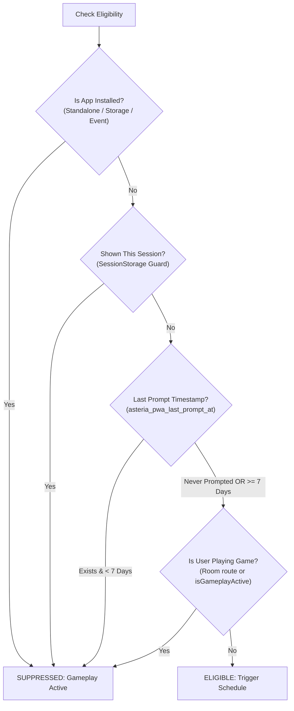

# PWA Promotion Frequency & Eligibility Logic
**Specification:** 7-Day Display Schedule & Gameplay Protection  
**Storage Keys:** `asteria_pwa_last_prompt_at`, `asteria_pwa_installed`, `asteria_pwa_prompt_shown_session`  
**Cooldown Constant:** `604,800,000 ms` (7 calendar days)  

---

## 1. Eligibility Decision Tree

Every time a page renders or user interactions occur, `checkPromotionEligibility()` evaluates the player state against a strict 4-step gate:



---

## 2. Trigger Conditions (Phase 2 Specification)

### 2.1 First-Time Visitor Rule
- **Timer Trigger:** One-shot timer fires after **30 seconds of continuous browsing** on an eligible page.
- **Meaningful Interaction Trigger:** If the user scrolls past 200px or performs a meaningful click after a brief 1-second hydration window, the promotion is presented without waiting the full 30 seconds.
- **No Infinite Loops:** Timers and event listeners are removed (`cleanupListeners()`) as soon as the promotion appears. Repetitive polling intervals (`setInterval`) are forbidden.

### 2.2 Immediate Timestamp Persistence
The moment the promotion appears, the current epoch timestamp is stored in `localStorage`:
```typescript
const now = Date.now();
localStorage.setItem('asteria_pwa_last_prompt_at', String(now));
sessionStorage.setItem('asteria_pwa_prompt_shown_session', 'true');
```
This guarantees that even if the visitor closes the browser tab or refreshes immediately, the 7-day cooldown is already active.

### 2.3 Dismissal Scenarios & Cooldown Enforcement
1. **User clicks "Maybe Later":** Modal closes, timestamp updated/enforced, audio haptic feedback plays.
2. **User clicks close button (X):** Modal closes, 7-day cooldown enforced.
3. **User presses Escape key or taps outside:** Modal closes, 7-day cooldown enforced.
4. **Native prompt dismissed:** If the user opens the native install dialog and taps "Cancel" / "Dismiss", the promotion closes and cooldown is enforced.

### 2.4 Seven-Day Expiration Reappearance
When a visitor returns after 7 days:
```typescript
const lastPromptAt = parseInt(localStorage.getItem('asteria_pwa_last_prompt_at'), 10);
const elapsed = Date.now() - lastPromptAt;

if (elapsed >= 7 * 24 * 60 * 60 * 1000) {
  // 7 days have passed: user is eligible again
  return true;
}
```

---

## 3. Active Gameplay Protection (Rule 8)

The system ensures zero interruption during gameplay:

1. **Route Check:** If `window.location.pathname.includes('/room/')`, the visitor is in a live multiplayer room with real-time turns. Promotion is completely suppressed.
2. **State Check:** `isGameplayActive()` checks whether Truth or Dare cards are in play, the bottle spinner is spinning, or a local game round is ongoing.
3. **Dynamic Cancellation:** If a promotion is scheduled and the player starts a game, `subscribeGameplayActive()` automatically cancels the pending timer and suppresses display.

