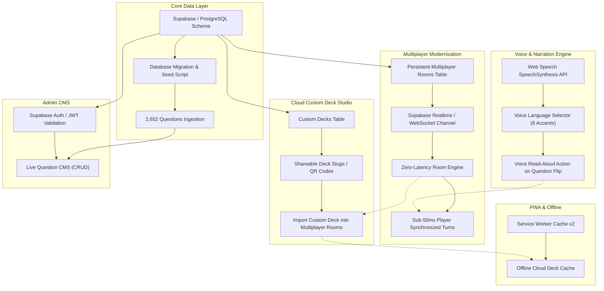

# Master Technical Upgrade Plan
**Platform:** Asteria Party Gaming Platform (`https://truthordarequiz.com`)  
**Role:** CTO & Senior Full-Stack Architect  
**Date:** November 7, 2026  
**Status:** Pre-Implementation Architectural Blueprint  

---

## 1. Upgrade Objectives & Principles

This master upgrade plan elevates Asteria from an in-memory party gaming platform to an enterprise, cloud-persisted, real-time gaming ecosystem.

### Core Non-Negotiable Rules:
1. **Zero Downtime & Non-Destructive Migrations:** Never overwrite or break existing working functionality (Pass & Play, PWA, 2,652 verified multilingual questions, and existing routing must remain 100% operational).
2. **Strict Backwards Compatibility:** Unauthenticated local players and offline PWA gamers must experience zero friction.
3. **Progressive Enhancement:** Advanced features (Realtime sockets, voice narration, cloud decks) must gracefully degrade to offline fallbacks when network or browser APIs are unavailable.

---

## 2. Feature Dependency Graph

### Critical Dependency Pathways:
1. **Multiplayer Realtime requires Persistent PostgreSQL Table:** Before replacing HTTP polling with Supabase Realtime channels, `multiplayer_rooms` and `room_players` must be active in PostgreSQL with atomic updates.
2. **Multiplayer Custom Decks require Cloud Custom Deck Storage:** Players cannot load custom decks into multiplayer rooms across multiple devices until custom decks are saved to the cloud with unique IDs.
3. **Voice Engine is Independent:** The Web Speech API SpeechSynthesis integration can be built and tested independently of database migrations, providing immediate value to all solo, pass-and-play, and multiplayer game modes.

---

## 3. Phased Execution Roadmap

### Phase 1: Voice & Audio Narration Engine (Zero Risk, High User Value)
- **Objective:** Add text-to-speech voice narration so questions are automatically or manually read aloud at party gatherings.
- **Implementation:**
  - Build `lib/audio/speechSynthesizer.ts` utilizing native `window.speechSynthesis` and `SpeechSynthesisUtterance`.
  - Provide voice accent mapping matching all 8 languages (`en-US`/`en-GB`, `hi-IN`, `es-ES`, `pt-BR`, `fr-FR`, `id-ID`, `ar-SA`, `de-DE`).
  - Add "Read Aloud" voice speaker button to `Card3D.tsx` and game screens.
  - Expose global voice toggle with pitch and rate controls.

### Phase 2: Database Persistence & Seeding (PostgreSQL Integration)
- **Objective:** Connect `@supabase/supabase-js` client to production database and seed initial catalog.
- **Implementation:**
  - Set up `lib/db/supabaseClient.ts` with secure environment variables (`NEXT_PUBLIC_SUPABASE_URL`, `SUPABASE_SERVICE_ROLE_KEY`).
  - Run database migration `20261105000000_initial_schema.sql`.
  - Create idempotent seed script `scripts/seed-questions.ts` to ingest all 2,652 verified questions from `lib/questions/database/`.
  - Verify zero duplicates and accurate category/intensity ratings.

### Phase 3: Realtime Multiplayer Modernization (WebSockets / Push Channels)
- **Objective:** Eliminate 1.5s client HTTP polling in favor of push-based sub-50ms synchronized turns.
- **Implementation:**
  - Create Supabase Realtime channel `room:[code]` subscription in `RoomClient.tsx`.
  - Update `lib/multiplayer/roomEngine.ts` to broadcast room state mutations (`FLIP_CARD`, `NEXT_TURN`, `SEND_EMOJI`) over Realtime broadcast channels.
  - Implement fallback to HTTP polling if WebSocket connection drops on unstable cellular networks.
  - Empirical verification: Measure latency reduction from 1,500ms to < 50ms.

### Phase 4: Cloud Custom Deck Studio & Multiplayer Sharing
- **Objective:** Transform local-only custom decks into cloud-shareable decks that can be loaded into any multiplayer room.
- **Implementation:**
  - Wire `CustomDeckClient.tsx` to `custom_questions` table.
  - Generate 6-character deck share codes (e.g. `DECK-49A8`).
  - Add "Play in Multiplayer Room" action, injecting user-created questions into live party rooms.
  - Cache user custom decks in IndexedDB / LocalStorage for offline PWA operation.

### Phase 5: Superadmin Live Question CMS & Telemetry
- **Objective:** Enable superadmins to create, edit, translate, and moderate questions directly in production without rebuilding the app.
- **Implementation:**
  - Connect `AdminDashboardClient.tsx` to PostgreSQL `questions` table.
  - Implement full CRUD handlers (Create, Update, Delete, Toggle NSFW).
  - Add batch CSV/JSON export and import capabilities.
