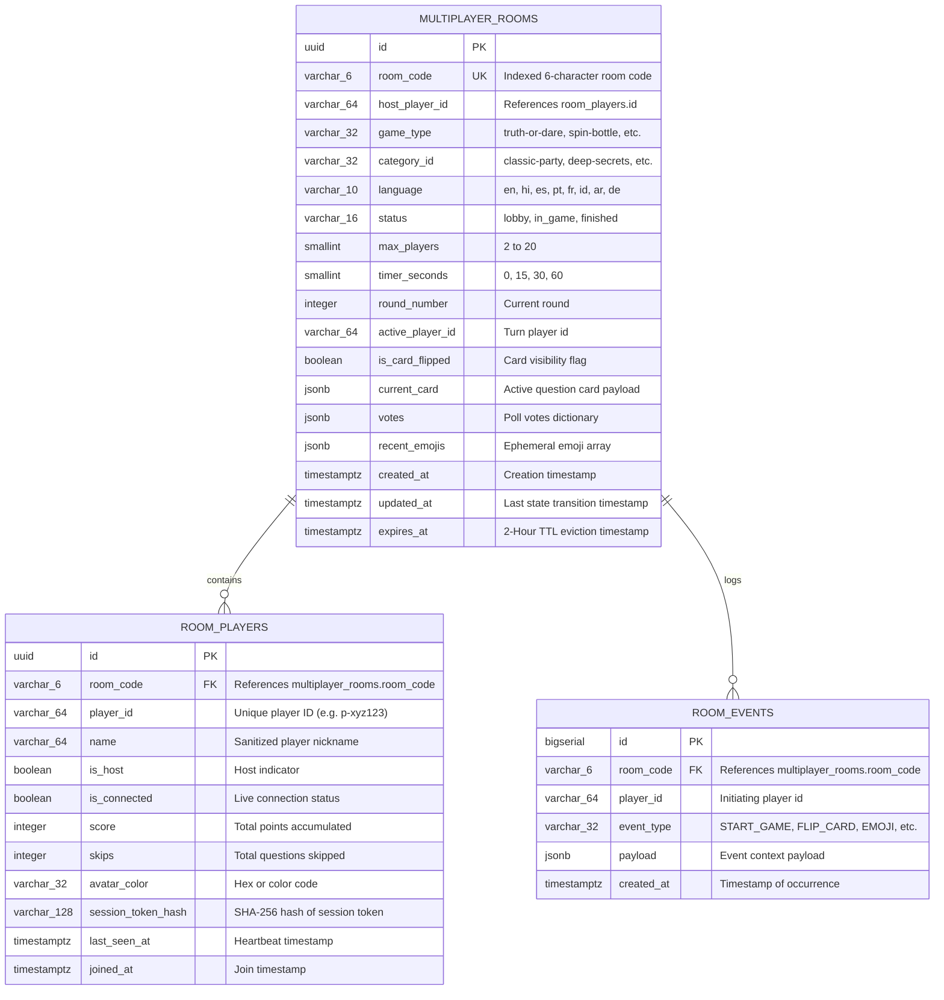

# Asteria Multiplayer Database Schema & Persistence Specification

> **Document Version:** 1.0.0  
> **Status:** Production-Ready  
> **Database Engine:** PostgreSQL 15+ / Supabase  
> **Target Schema:** `public`  

---

## 1. Relational Entity Architecture



---

## 2. PostgreSQL DDL Migrations

```sql
-- ==========================================================
-- 1. MULTIPLAYER ROOMS TABLE
-- ==========================================================
CREATE TABLE IF NOT EXISTS public.multiplayer_rooms (
    id UUID PRIMARY KEY DEFAULT gen_random_uuid(),
    room_code VARCHAR(6) NOT NULL UNIQUE,
    host_player_id VARCHAR(64) NOT NULL,
    game_type VARCHAR(32) NOT NULL DEFAULT 'truth-or-dare',
    category_id VARCHAR(32) NOT NULL DEFAULT 'classic-party',
    language VARCHAR(10) NOT NULL DEFAULT 'en',
    status VARCHAR(16) NOT NULL DEFAULT 'lobby' CHECK (status IN ('lobby', 'in_game', 'finished')),
    max_players SMALLINT NOT NULL DEFAULT 12 CHECK (max_players >= 2 AND max_players <= 20),
    timer_seconds SMALLINT NOT NULL DEFAULT 30 CHECK (timer_seconds IN (0, 15, 30, 60)),
    round_number INTEGER NOT NULL DEFAULT 1 CHECK (round_number >= 1),
    active_player_id VARCHAR(64) NOT NULL,
    is_card_flipped BOOLEAN NOT NULL DEFAULT FALSE,
    current_card JSONB DEFAULT NULL,
    votes JSONB DEFAULT '{}'::jsonb,
    recent_emojis JSONB DEFAULT '[]'::jsonb,
    created_at TIMESTAMPTZ NOT NULL DEFAULT timezone('utc'::text, now()),
    updated_at TIMESTAMPTZ NOT NULL DEFAULT timezone('utc'::text, now()),
    expires_at TIMESTAMPTZ NOT NULL DEFAULT (timezone('utc'::text, now()) + INTERVAL '2 hours')
);

-- Indexes for lightning-fast room lookup and periodic TTL purging
CREATE INDEX IF NOT EXISTS idx_multiplayer_rooms_code ON public.multiplayer_rooms (room_code);
CREATE INDEX IF NOT EXISTS idx_multiplayer_rooms_expires ON public.multiplayer_rooms (expires_at);

-- ==========================================================
-- 2. ROOM PLAYERS TABLE
-- ==========================================================
CREATE TABLE IF NOT EXISTS public.room_players (
    id UUID PRIMARY KEY DEFAULT gen_random_uuid(),
    room_code VARCHAR(6) NOT NULL REFERENCES public.multiplayer_rooms(room_code) ON DELETE CASCADE,
    player_id VARCHAR(64) NOT NULL,
    name VARCHAR(64) NOT NULL,
    is_host BOOLEAN NOT NULL DEFAULT FALSE,
    is_connected BOOLEAN NOT NULL DEFAULT TRUE,
    score INTEGER NOT NULL DEFAULT 0,
    skips INTEGER NOT NULL DEFAULT 0,
    avatar_color VARCHAR(32) NOT NULL DEFAULT '#8B5CF6',
    session_token_hash VARCHAR(128) NOT NULL,
    last_seen_at TIMESTAMPTZ NOT NULL DEFAULT timezone('utc'::text, now()),
    joined_at TIMESTAMPTZ NOT NULL DEFAULT timezone('utc'::text, now()),
    CONSTRAINT uq_room_player_id UNIQUE (room_code, player_id),
    CONSTRAINT uq_room_player_name UNIQUE (room_code, name)
);

CREATE INDEX IF NOT EXISTS idx_room_players_room_code ON public.room_players (room_code);
CREATE INDEX IF NOT EXISTS idx_room_players_token_hash ON public.room_players (session_token_hash);
CREATE INDEX IF NOT EXISTS idx_room_players_last_seen ON public.room_players (last_seen_at);

-- ==========================================================
-- 3. ROOM EVENTS AUDIT / REALTIME BROADCAST LOG
-- ==========================================================
CREATE TABLE IF NOT EXISTS public.room_events (
    id BIGSERIAL PRIMARY KEY,
    room_code VARCHAR(6) NOT NULL REFERENCES public.multiplayer_rooms(room_code) ON DELETE CASCADE,
    player_id VARCHAR(64) NOT NULL,
    event_type VARCHAR(32) NOT NULL,
    payload JSONB DEFAULT '{}'::jsonb,
    created_at TIMESTAMPTZ NOT NULL DEFAULT timezone('utc'::text, now())
);

CREATE INDEX IF NOT EXISTS idx_room_events_room_created ON public.room_events (room_code, created_at DESC);
```

---

## 3. Row Level Security (RLS) Policies

To protect room security while allowing unauthenticated guest multiplayer participants:

```sql
-- Enable RLS
ALTER TABLE public.multiplayer_rooms ENABLE ROW LEVEL SECURITY;
ALTER TABLE public.room_players ENABLE ROW LEVEL SECURITY;
ALTER TABLE public.room_events ENABLE ROW LEVEL SECURITY;

-- 1. Rooms: Anyone can read an active room if they know the 6-character room code
CREATE POLICY "Public read access to active rooms by room code"
    ON public.multiplayer_rooms
    FOR SELECT
    USING (expires_at > timezone('utc'::text, now()));

-- 2. Rooms: Only service-role (server API routes) can perform INSERT, UPDATE, DELETE
CREATE POLICY "Service role manages room state"
    ON public.multiplayer_rooms
    FOR ALL
    TO service_role
    USING (true)
    WITH CHECK (true);

-- 3. Players: Anyone in room can view participant roster
CREATE POLICY "Public read access to room players"
    ON public.room_players
    FOR SELECT
    USING (true);

-- 4. Players: Service role manages player records
CREATE POLICY "Service role manages players"
    ON public.room_players
    FOR ALL
    TO service_role
    USING (true)
    WITH CHECK (true);
```

---

## 4. Automatic TTL Purging & Stale Connection Sweeper

To guarantee the database never leaks memory or accumulates abandoned games:

```sql
-- Function to clean up expired rooms (2-hour TTL)
CREATE OR REPLACE FUNCTION public.purge_expired_multiplayer_rooms()
RETURNS integer
LANGUAGE plpgsql
SECURITY DEFINER
AS $$
DECLARE
    deleted_count integer;
BEGIN
    DELETE FROM public.multiplayer_rooms
    WHERE expires_at < timezone('utc'::text, now());
    GET DIAGNOSTICS deleted_count = ROW_COUNT;
    RETURN deleted_count;
END;
$$;

-- Function to mark players inactive if no heartbeat in > 35 seconds
CREATE OR REPLACE FUNCTION public.mark_inactive_room_players()
RETURNS integer
LANGUAGE plpgsql
SECURITY DEFINER
AS $$
DECLARE
    updated_count integer;
BEGIN
    UPDATE public.room_players
    SET is_connected = FALSE
    WHERE is_connected = TRUE
      AND last_seen_at < (timezone('utc'::text, now()) - INTERVAL '35 seconds');
    GET DIAGNOSTICS updated_count = ROW_COUNT;
    RETURN updated_count;
END;
$$;
```
