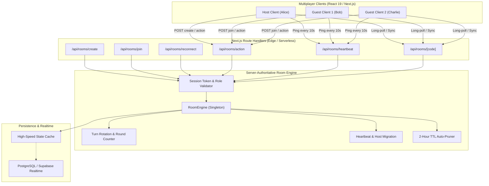
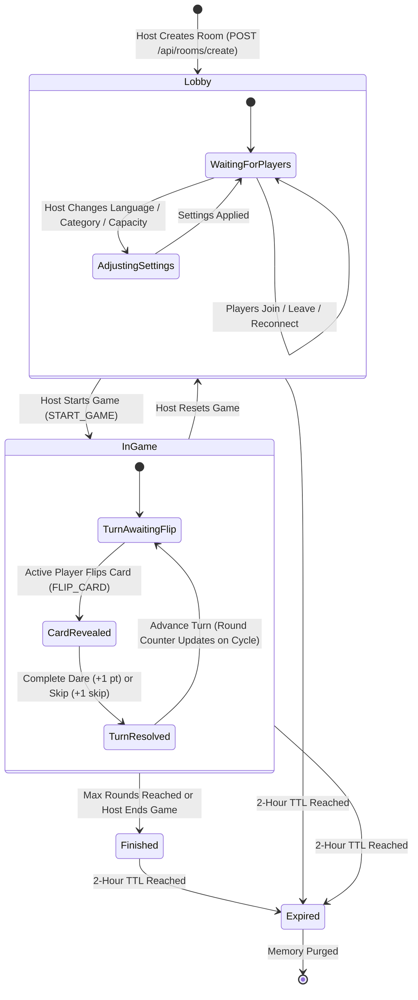
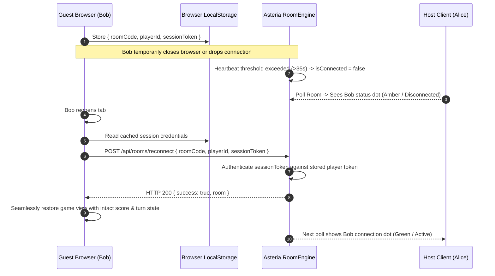

# Asteria Multiplayer Room Architecture

> **Document Version:** 1.0.0  
> **Status:** Production-Ready  
> **Target System:** Asteria Real-Time Multiplayer Gaming Platform  
> **Author:** Senior Full-Stack Multiplayer Game Developer  

---

## 1. System Overview

Asteria's real-time multiplayer system enables seamless, zero-latency party gaming for 2 to 20 concurrent participants per room. It supports **Truth or Dare**, **Never Have I Ever**, **Would You Rather**, **Most Likely To**, and **This or That**, offering server-authoritative state synchronisation, automated host migration, session-persistent reconnection, and language-independent client interfaces.

---

## 2. Room Lifecycle State Machine

A room transitions through deterministic lifecycle phases enforced strictly by the server:

### Lifecycle Details
1. **Lobby (`status: 'lobby'`)**:
   - Unique 6-character room code generated (e.g., `TRU789`).
   - Host configures shared question language (e.g., English, Hindi, Spanish, Arabic), deck category, player capacity (2-20), and turn countdown timer.
   - Non-hosts can join, receive avatars, and signal readiness. Non-host attempts to alter settings or start the game receive HTTP 403.
2. **In-Game (`status: 'in_game'`)**:
   - Deterministic turn ordering initialized from the joined players list.
   - Current turn assigned to `activePlayerId`.
   - Actions restricted strictly: only the active player (or host fallback) can flip the card and resolve the turn.
   - Round counter increments dynamically when turn cycles back to player 0.
3. **Expiration (2-Hour TTL)**:
   - Each room maintains `expiresAt = Date.now() + 2 * 60 * 60 * 1000`.
   - Access attempts past `expiresAt` instantly trigger deletion.
   - Background periodic garbage collection sweeps expired rooms every 10 minutes.

---

## 3. Server-Authoritative Concurrency Model

Asteria completely avoids peer-to-peer race conditions and client-authoritative state tampering:

1. **Atomic Turn Mutation**:
   - `RoomEngine.dispatchAction()` verifies that the incoming `playerId` matches `room.activePlayerId` or `room.hostPlayerId`.
   - If an unauthorized guest attempts `FLIP_CARD` or `COMPLETE_DARE`, the action is rejected immediately with an explicit error.
2. **Duplicate Flip Lock**:
   - When a card is flipped (`room.isCardFlipped = true`), subsequent `FLIP_CARD` dispatches are blocked until the card is resolved via `COMPLETE_DARE` or `SKIP_TURN`.
3. **Turn Rotation Calculation**:
   $$\text{nextIndex} = (\text{currentIndex} + 1) \pmod{\text{players.length}}$$
   When $\text{nextIndex} = 0$, $\text{roundNumber} \leftarrow \text{roundNumber} + 1$.

---

## 4. Reconnection & Host Migration Architecture

Disconnections due to spotty mobile connections, background tab sleep, or browser refreshes are handled gracefully:

### Automatic Host Migration
If the room host disconnects or leaves voluntarily:
1. `leaveRoom()` detects `room.hostPlayerId === departingPlayerId`.
2. The server instantly promotes `room.players[0]` to the new host (`isHost: true`).
3. `room.hostPlayerId` is updated to the promoted player's ID.
4. The remaining players receive updated room state on their next sync cycle with the host crown 👑 rendered next to the new host.

### Orphan Active Player Protection
If the player whose turn is currently active abruptly leaves mid-turn:
1. The server detects `room.activePlayerId === departingPlayerId`.
2. The active turn is immediately advanced to `room.players[0].id`.
3. `isCardFlipped` is reset to `false` and `currentCard` is set to `null`.
4. The room is protected against deadlock.

---

## 5. Multilingual Separation Architecture

Asteria maintains a decoupled language model:
- **Shared Question Language (`room.language`)**: Selected by the host in the lobby (e.g., `hi` for Hindi). All drawn cards are queried and drawn strictly from that language's authenticated question database.
- **Client UI Language (`useTranslation().language`)**: Each player retains independent choice of interface language (labels, buttons, tooltips, dialogs). For instance, in an English-question party room, a Spanish-speaking player sees the Spanish UI chrome while reading the English question drawn for the room.

