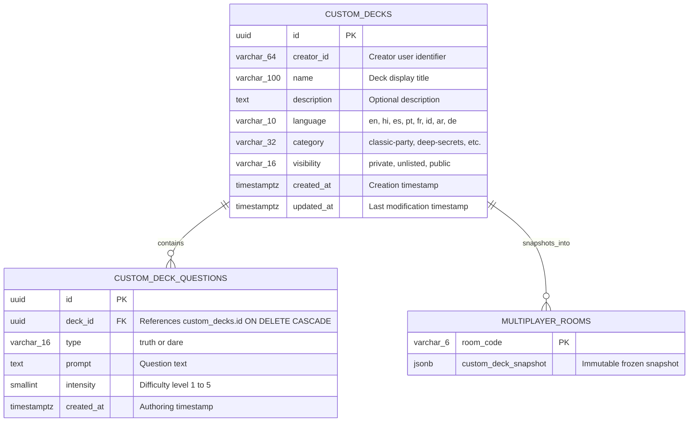

# Asteria Custom Deck Database Architecture & Migration Specification

> **Document Version:** 1.0.0  
> **Status:** Production-Ready  
> **Database Engine:** PostgreSQL 15+ / Supabase  
> **Schema:** `public`  

---

## 1. Relational Schema Architecture



---

## 2. PostgreSQL DDL Migrations

```sql
-- ==========================================================
-- 1. CUSTOM DECKS TABLE
-- ==========================================================
CREATE TABLE IF NOT EXISTS public.custom_decks (
    id UUID PRIMARY KEY DEFAULT gen_random_uuid(),
    creator_id VARCHAR(64) NOT NULL,
    name VARCHAR(100) NOT NULL,
    description TEXT DEFAULT '',
    language VARCHAR(10) NOT NULL DEFAULT 'en',
    category VARCHAR(32) NOT NULL DEFAULT 'classic-party',
    visibility VARCHAR(16) NOT NULL DEFAULT 'private' CHECK (visibility IN ('private', 'unlisted', 'public')),
    created_at TIMESTAMPTZ NOT NULL DEFAULT timezone('utc'::text, now()),
    updated_at TIMESTAMPTZ NOT NULL DEFAULT timezone('utc'::text, now())
);

CREATE INDEX IF NOT EXISTS idx_custom_decks_creator ON public.custom_decks (creator_id);
CREATE INDEX IF NOT EXISTS idx_custom_decks_visibility ON public.custom_decks (visibility);
CREATE INDEX IF NOT EXISTS idx_custom_decks_language ON public.custom_decks (language);

-- ==========================================================
-- 2. CUSTOM DECK QUESTIONS TABLE
-- ==========================================================
CREATE TABLE IF NOT EXISTS public.custom_deck_questions (
    id UUID PRIMARY KEY DEFAULT gen_random_uuid(),
    deck_id UUID NOT NULL REFERENCES public.custom_decks(id) ON DELETE CASCADE,
    type VARCHAR(16) NOT NULL CHECK (type IN ('truth', 'dare')),
    prompt TEXT NOT NULL,
    intensity SMALLINT NOT NULL DEFAULT 3 CHECK (intensity >= 1 AND intensity <= 5),
    created_at TIMESTAMPTZ NOT NULL DEFAULT timezone('utc'::text, now())
);

CREATE INDEX IF NOT EXISTS idx_custom_deck_questions_deck ON public.custom_deck_questions (deck_id);
CREATE INDEX IF NOT EXISTS idx_custom_deck_questions_type ON public.custom_deck_questions (type);
```

---

## 3. Row Level Security (RLS) Policies

To protect private custom decks while permitting public community decks:

```sql
ALTER TABLE public.custom_decks ENABLE ROW LEVEL SECURITY;
ALTER TABLE public.custom_deck_questions ENABLE ROW LEVEL SECURITY;

-- 1. Public or Unlisted Decks can be viewed by anyone with the link
CREATE POLICY "Public decks visible to all"
    ON public.custom_decks
    FOR SELECT
    USING (visibility IN ('public', 'unlisted') OR creator_id = auth.uid()::text);

-- 2. Only Deck Creators can Insert, Update, or Delete their own Decks
CREATE POLICY "Creators manage their decks"
    ON public.custom_decks
    FOR ALL
    USING (creator_id = auth.uid()::text)
    WITH CHECK (creator_id = auth.uid()::text);

-- 3. Questions readable if parent deck is readable
CREATE POLICY "Questions visible if deck is readable"
    ON public.custom_deck_questions
    FOR SELECT
    USING (
        EXISTS (
            SELECT 1 FROM public.custom_decks d
            WHERE d.id = deck_id
              AND (d.visibility IN ('public', 'unlisted') OR d.creator_id = auth.uid()::text)
        )
    );

-- 4. Service Role overrides for Next.js API Handlers
CREATE POLICY "Service role full access to custom decks"
    ON public.custom_decks
    FOR ALL
    TO service_role
    USING (true)
    WITH CHECK (true);

CREATE POLICY "Service role full access to custom deck questions"
    ON public.custom_deck_questions
    FOR ALL
    TO service_role
    USING (true)
    WITH CHECK (true);
```

---

## 4. API Endpoints Integration

- **`GET /api/custom-decks`**: Lists custom decks filtered by `creatorId` (from query param or `x-creator-id` header) plus public showcase decks.
- **`POST /api/custom-decks`**: Validates question constraints, sanitizes prompts, and saves custom decks.
- **`GET /api/custom-decks/[id]`**: Retrieves deck metadata and question roster with visibility authorization checks.
- **`PUT /api/custom-decks/[id]`**: Updates deck properties and questions with strict creator authentication.
- **`DELETE /api/custom-decks/[id]`**: Deletes deck and cascades to all child questions.

