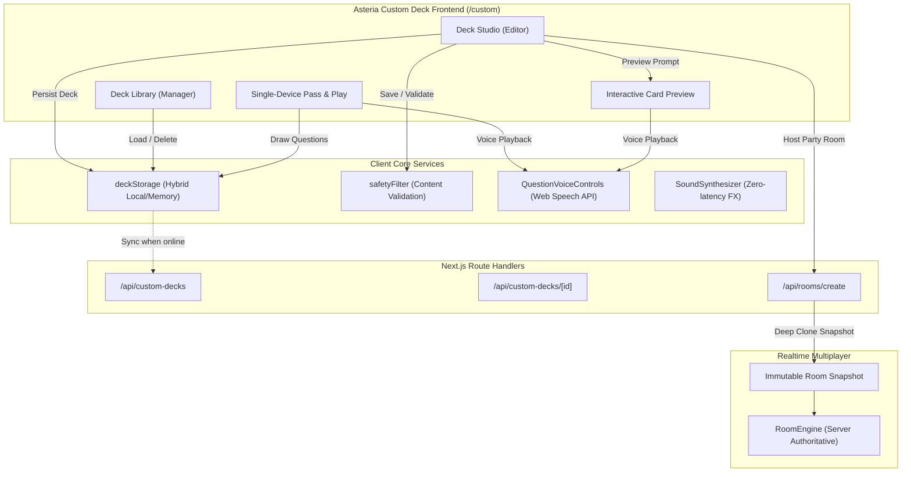
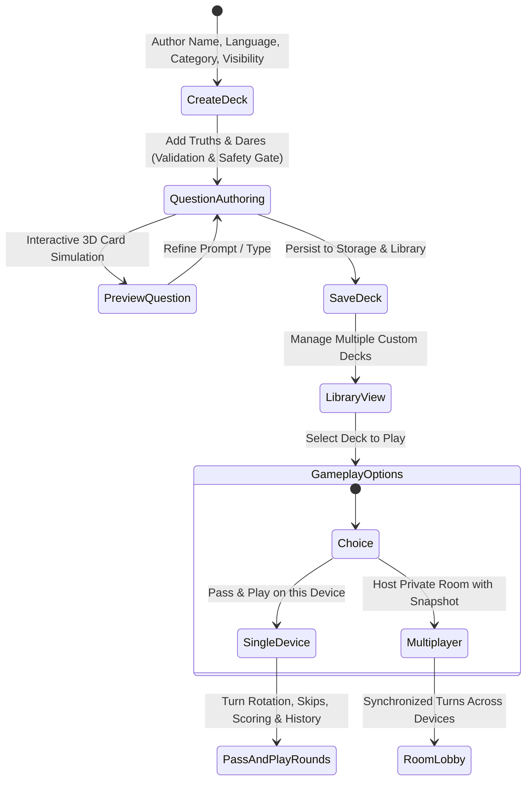

# Asteria Custom Deck Architecture & Design Specification

> **Document Version:** 1.0.0  
> **Status:** Production-Ready  
> **Target Subsystem:** Asteria Custom Deck Studio, Library & Gameplay Engine  
> **Author:** Senior Full-Stack Developer & Game Product Engineer  

---

## 1. Executive Summary

The Asteria Custom Deck system empowers players to author, organize, voice-play, and share tailored Truth or Dare card packs with friends. This architecture replaces the legacy single-deck, export-dependent implementation with a multi-deck creator studio, robust content safety filtering, local pass-and-play party sessions, and private multiplayer rooms featuring immutable deck snapshots.

### Complete Removal of Export JSON
In accordance with design specifications, all "Export JSON" functionality has been permanently and cleanly removed:
- Removed Export JSON button and icon from [`CustomDeckClient.tsx`](file:///Users/vaibhavborkar/truth&dare/components/custom/CustomDeckClient.tsx).
- Removed `handleExport` download file generation routine.
- Removed `exportDeck` keys from all 8 global language translation dictionaries (`en`, `hi`, `es`, `pt`, `fr`, `id`, `ar`, `de`) and TypeScript definition [`TranslationDictionary`](file:///Users/vaibhavborkar/truth&dare/lib/i18n/translations/types.ts).
- Cleaned metadata and content descriptions in [`QuestionsClient.tsx`](file:///Users/vaibhavborkar/truth&dare/components/questions/QuestionsClient.tsx) and [`app/custom/page.tsx`](file:///Users/vaibhavborkar/truth&dare/app/custom/page.tsx).

---

## 2. Component & System Topology

---

## 3. Custom Deck Lifecycle

### Key Phases
1. **Deck Creation**: Users define title, optional description, question language (supporting all 8 global languages), category tag, and visibility (`private`, `unlisted`, `public`).
2. **Question Management**: Inline validation detects empty inputs, prevents intra-deck duplicate prompts, enforces a 250-character limit, and filters unsafe content.
3. **Library Management**: Lists all decks owned by the visitor, showing card metrics (truths, dares, total), last modified timestamps, and actions.
4. **Single-Device Pass-and-Play**: Local multiplayer engine supporting 2 to 20 players, turn indicators, 3D card flips, score tracking, skip tracking, and session history.
5. **Multiplayer Integration**: Creates an immutable, deep-cloned snapshot attached to the multiplayer room.

---

## 4. Multi-Deck Library Storage Architecture

### Hybrid Storage (`deckStorage`)
Asteria implements a hybrid client repository in [`lib/custom/deckStorage.ts`](file:///Users/vaibhavborkar/truth&dare/lib/custom/deckStorage.ts):
- **Browser Execution**: Persists array of `CustomDeck` records under `localStorage.getItem('asteria_custom_decks')`.
- **Node.js / Vitest / SSR**: Transparent fallback to an in-memory dictionary to prevent runtime crashes when `window.localStorage` is unavailable.
- **Legacy Migration**: Automatically detects existing `asteria_custom_deck` (single-deck format) on startup, converts prompts into the new `CustomDeck` schema, saves it to the library, and cleans up the legacy key.

### Creator Ownership Enforcement
Every browser generates an anonymous persistent creator ID (`asteria_user_id`, e.g., `usr_9a8b7c6_1730985600`). When modifying or deleting decks, `deckStorage` and `/api/custom-decks/[id]` enforce:
$$\text{deck.creatorId} \equiv \text{currentCreatorId}$$
Any attempt by a third party to mutate another user's deck is blocked with an HTTP 401/403 or storage error.

