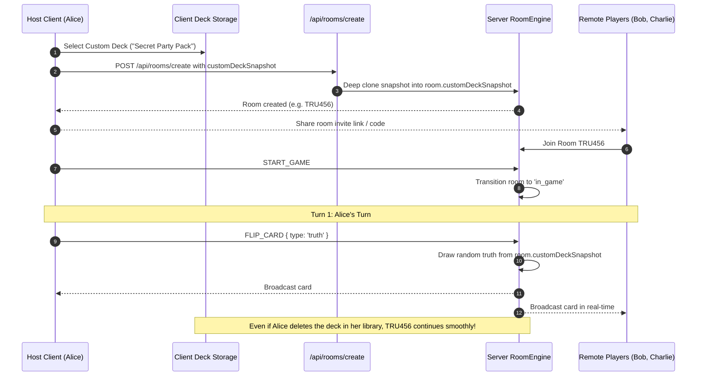

# Asteria Custom Deck Multiplayer Integration Specification

> **Document Version:** 1.0.0  
> **Status:** Production-Ready  
> **Subsystem:** Real-Time Multiplayer Room & Custom Deck Bridge  

---

## 1. System Overview

Asteria allows any player to take a private custom deck created in their browser and host a real-time multiplayer room for up to 20 remote participants. 

To solve the challenges of multiplayer data distribution, consistency, and security, Asteria introduces an **Immutable Room Snapshot Architecture**.



---

## 2. Immutable Deck Snapshot Architecture

### The Problem
If a multiplayer game relied on live references to a creator's custom deck:
1. If the host edited a question mid-game, players might experience out-of-sync prompts.
2. If the host deleted the deck, the active room could crash or deadlock.
3. If the host lost internet connection, other room participants would lose access to the card pool.

### The Solution: Deep Cloned Snapshot
When a room is established via `POST /api/rooms/create`, the server extracts a complete deep clone of the deck:

```ts
const customDeckSnapshot = params.customDeckSnapshot
  ? {
      id: params.customDeckSnapshot.id,
      name: params.customDeckSnapshot.name,
      language: params.customDeckSnapshot.language,
      questions: params.customDeckSnapshot.questions.map((q) => ({ ...q })),
    }
  : null;
```

### Guarantees
- **Immutability**: Mutating the source deck in local storage or the database has **0 impact** on active room gameplay.
- **Privacy & Confinement**: The deck is encapsulated strictly within the room. External visitors cannot query, scrape, or browse the private questions.
- **Resilience**: The room functions autonomously for its full 2-hour TTL even if the creator closes their browser.

---

## 3. Server-Authoritative Card Drawing

When a player triggers `FLIP_CARD` in a room configured with a custom deck:
1. `RoomEngine` inspects `room.customDeckSnapshot`.
2. It filters the snapshot for the requested question type (`truth` or `dare`).
3. If questions of that type exist, it randomly selects one from that pool.
4. It wraps the selected custom question into a standardized `Question` object and assigns it to `room.currentCard`.
5. The card is synchronized to all connected players on their next sync or WebSocket event.

---

## 4. Turn & Score Synchronization

- **Turn Progression**: Deterministic player turns rotate sequentially through the room roster.
- **Score Attribution**: Completing a custom dare awards `+1` point to the active player's score.
- **Skip Handling**: Skipping advances the active turn and increments the player's skip counter.
- **Round Advancement**: When the active turn cycles back to player 0, `room.roundNumber` automatically increments.

