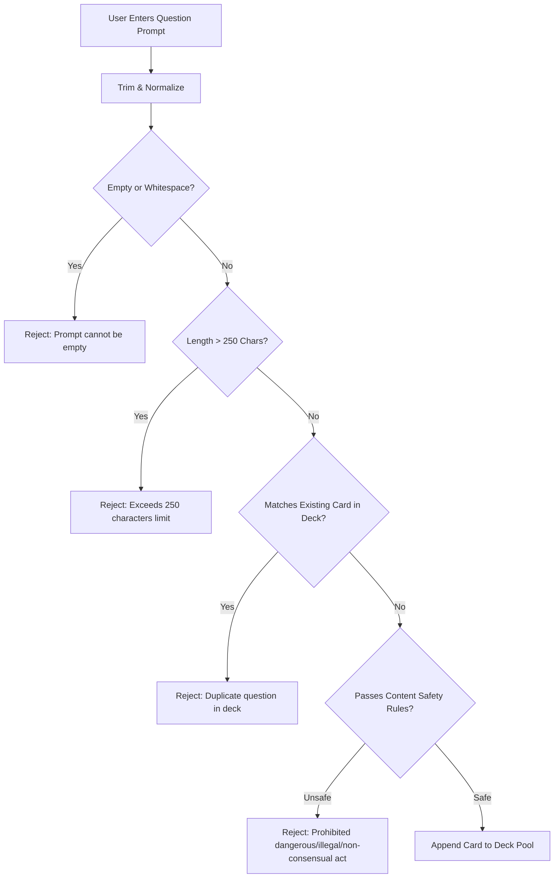

# Asteria Custom Deck Question Management & Validation

> **Document Version:** 1.0.0  
> **Status:** Production-Ready  
> **Target Subsystem:** Card Authoring, Editing, Live Validation & Safety Pipeline  

---

## 1. Question Management Overview

The Custom Deck Question Management subsystem handles adding, editing, deleting, previewing, and validating Truth and Dare questions. Every question authored passes through a multi-stage validation and safety pipeline before joining the active deck pool.

---

## 2. Validation Rules & Criteria

| Rule | Requirement | Implementation | User Feedback |
|------|-------------|----------------|---------------|
| **Empty Check** | Questions must contain meaningful text | `!prompt.trim()` | `'Question prompt cannot be empty or only spaces.'` |
| **Length Check** | Hard limit of 250 characters | `prompt.trim().length > 250` | `'Question exceeds the maximum length of 250 characters (X/250).'` |
| **Duplicate Check** | Prevent identical questions in the same deck | Case-insensitive and trimmed comparison against `questions.map(q => q.prompt)` | `'This exact question already exists in this deck.'` |
| **Safety Check** | Block illegal, violent, self-harm, or non-consensual prompts | Multi-lingual regex scanning via `validateQuestionSafety()` | Specific category reason (e.g. `'Prompts involving physical injury or self-harm are prohibited.'`) |

---

## 3. Question Operations

### 3.1 Adding Questions
- Authors select card type: **TRUTH** (Cyan/Truth styling) or **DARE** (Coral/Dare styling).
- Text input provides a dynamic character counter (`{length}/250 chars`) turning amber as users approach the 250-character limit.
- Clicking **Add Card to Deck** (`Enter` shortcut enabled) validates constraints and triggers haptic feedback.

### 3.2 Editing Questions
- Users can click the edit icon on any card row to initiate inline editing.
- Authors can modify the prompt text or toggle between Truth and Dare.
- Saving an edited card re-runs duplicate and safety validations, ignoring the current card's previous prompt.

### 3.3 Deleting Questions
- Instant removal via trash icon with haptic response.
- Question counters update reactively across the interface.

### 3.4 Interactive Card Preview
- Clicking the preview eye icon opens an interactive preview modal.
- Simulates the actual 3D card presentation players see during live gameplay.
- Includes full Web Speech API voice playback in the deck's configured language.

### 3.5 Question Metrics
The top banner maintains live reactive counters:
- **Truth Count**: Number of active truth prompts.
- **Dare Count**: Number of active dare challenges.
- **Total Count**: Combined card count (minimum 3 cards required to launch gameplay).
