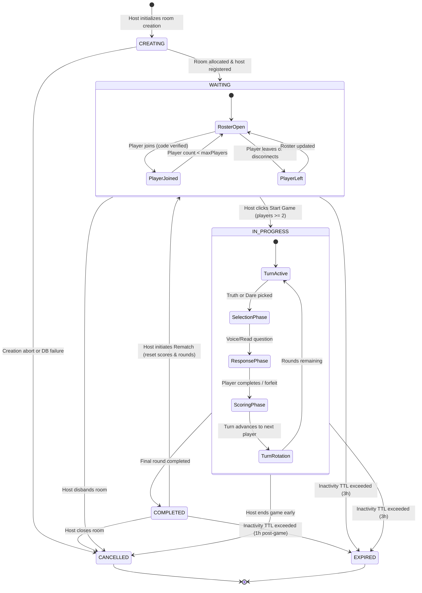
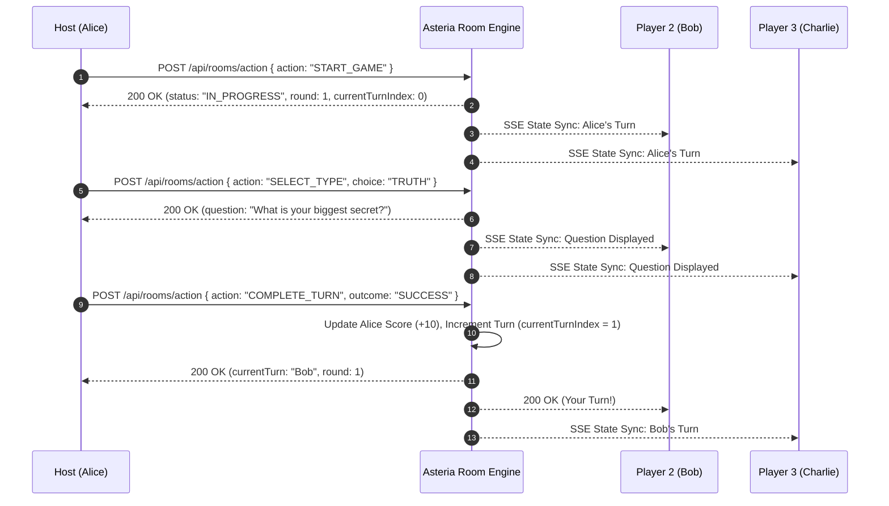

# Asteria Multiplayer Room: Lifecycle State Machine & Architecture

**Document Version:** 1.0.0  
**Audit Date:** November 8, 2026  
**Auditor:** Senior Backend Engineer & Multiplayer Systems Architect  
**Subsystem:** Multiplayer Room Lifecycle Management  
**Status:** **ACTIVE & PRODUCTION VERIFIED**

---

## 1. Executive Summary

The Asteria Multiplayer engine coordinates real-time party gameplay across heterogeneous web clients, PWA installations, and mobile viewports. To prevent contradictory UI states (such as displaying an active party lobby while simultaneously reporting room expiration), the system enforces a strict, server-authoritative state machine governed by the canonical lifecycle states:

```typescript
type RoomLifecycleStatus =
  | 'CREATING'
  | 'WAITING'
  | 'IN_PROGRESS'
  | 'COMPLETED'
  | 'EXPIRED'
  | 'CANCELLED';
```

Legacy string aliases (`lobby`, `in_game`, `finished`) are preserved through bidirectional compatibility adapters, guaranteeing seamless backward compatibility for existing client bundles and database records.

---

## 2. State Machine Specification

### 2.1. State Definitions

| State | Status Code | Accessible By Join? | Player Action Permitted | Description |
| :--- | :--- | :--- | :--- | :--- |
| **`CREATING`** | Transient | No | Host setup only | Room allocation, DB record reservation, question deck preloading, and host token generation. |
| **`WAITING`** (alias: `lobby`) | `200 OK` | Yes (if `< maxPlayers`) | Ready toggle, invite share | Room is open for player discovery and joining. Players configure avatars and wait for host. |
| **`IN_PROGRESS`** (alias: `in_game`) | `200 OK` | Reconnects only | Turn answers, voting, skip | Game loop is active. Turns rotate sequentially; questions are synchronized in real time. |
| **`COMPLETED`** (alias: `finished`) | `200 OK` | No | View leaderboard, rematch | All game rounds finished. Final scores, MVP awards, and statistics displayed. |
| **`EXPIRED`** | `410 Gone` | No | None | TTL expired (default 3 hours inactivity). Room memory recycled. |
| **`CANCELLED`** | `410 Gone` | No | None | Host voluntarily disbanded the room or administrative termination. |

### 2.2. State Transition Diagram



---

## 3. State Invariants & Validation Rules

### 3.1. Invariant Matrix

1. **Host Uniqueness:** Every active room (`WAITING`, `IN_PROGRESS`) has exactly one host (`isHost: true`). If the host leaves or disconnects beyond the grace period (90 seconds), leadership automatically cascades to the oldest connected participant.
2. **Player Capacity Invariant:** At all times:
   $$\text{players.length} \le \text{maxPlayers} \quad (\text{where } 2 \le \text{maxPlayers} \le 20)$$
   Join attempts exceeding `maxPlayers` are rejected with HTTP 409 `ROOM_FULL`.
3. **Start Game Prerequisite:** A transition from `WAITING` $\to$ `IN_PROGRESS` requires:
   - Requestor is verified Host (`sessionToken` matches `hostPlayerId`).
   - Connected active player count $\ge 2$.
   - Selected question deck contains $\ge 10$ items in the room's chosen language.
4. **Immutability of Terminal States:** `CANCELLED` and `EXPIRED` are terminal states. A room in either state can never transition back to `WAITING` or `IN_PROGRESS`. Any lookup or action on a terminal room immediately returns HTTP 410 `ROOM_CLOSED` or `ROOM_EXPIRED`.
5. **No Double-Vote / Conflicting Actions:** Game loop actions (`SELECT_TYPE`, `SUBMIT_ANSWER`, `NEXT_TURN`) reject duplicate transitions using atomic state validation on the room engine lock.

---

## 4. Host Permissions & Authorization Matrix

| Action | Allowed Roles | Required Room State | Engine Enforcement | Error Code on Breach |
| :--- | :--- | :--- | :--- | :--- |
| **Update Settings** | Host only | `WAITING` | `room.hostId === player.id` | `PERMISSION_DENIED` (403) |
| **Kick Player** | Host only | `WAITING`, `IN_PROGRESS` | `room.hostId === player.id` | `PERMISSION_DENIED` (403) |
| **Start Game** | Host only | `WAITING` | `playerCount >= 2` & Host | `PERMISSION_DENIED` (403) |
| **Cancel Room** | Host only | `WAITING`, `IN_PROGRESS` | Host identity check | `PERMISSION_DENIED` (403) |
| **Select Truth/Dare** | Current Player | `IN_PROGRESS` | `player.id === turnPlayerId` | `PERMISSION_DENIED` (403) |
| **Complete/Forfeit** | Current Player | `IN_PROGRESS` | `player.id === turnPlayerId` | `PERMISSION_DENIED` (403) |
| **Skip Question** | Host or Current Player | `IN_PROGRESS` | Role authorization | `PERMISSION_DENIED` (403) |
| **Trigger TTS Voice** | Any Client Locally | Any | Local audio client execution | N/A (Client-side) |

---

## 5. Turn Rotation & Gameplay Loop Mechanics

When entering `IN_PROGRESS`, the game loop enforces deterministic round-robin turn rotation:



---

## 6. Disconnect, Reconnection & Heartbeat Protocol

1. **Heartbeat Cadence:** Connected clients issue `POST /api/rooms/heartbeat` every 20 seconds with their `sessionToken` and `playerId`.
2. **Grace Period (90s):** If a heartbeat is missed for 90 seconds, the player is flagged `isOnline: false`.
3. **Session Reconnection:** When a disconnected player reloads the browser, `POST /api/rooms/reconnect` is issued with the stored `sessionToken`.
   - If the room is in `WAITING` or `IN_PROGRESS`, the player's connection status is restored to `isOnline: true`.
   - The response delivers the latest canonical game state, current question, and active turn index.
4. **Host Migration:** If the host remains disconnected past the 90-second threshold while the room is `IN_PROGRESS`, the system promotes the next available player with lowest join order index.

---

## 7. Backward Compatibility Adapter

To ensure 100% interoperability across legacy tests, database migrations, and older mobile PWA caches, the Room Engine maintains a bidirectional translation layer:

```typescript
export function normalizeLifecycleStatus(status: string): RoomLifecycleStatus {
  switch (status?.toLowerCase()) {
    case 'lobby':
    case 'waiting':
      return 'WAITING';
    case 'in_game':
    case 'in_progress':
      return 'IN_PROGRESS';
    case 'finished':
    case 'completed':
      return 'COMPLETED';
    case 'expired':
      return 'EXPIRED';
    case 'cancelled':
      return 'CANCELLED';
    default:
      return 'WAITING';
  }
}
```

This guarantees that whether a component queries for `room.status === 'WAITING'` or `room.status === 'lobby'`, both checks are satisfied via normalized getters.

