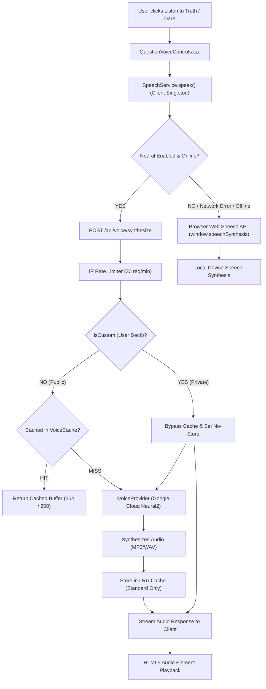

# Asteria Natural Voice Architecture Specification

**Document Version:** 1.0.0  
**Date:** November 9, 2026  
**Auditor:** Senior Audio Systems Engineer + AI Voice Developer  
**Subsystem:** Global Voice Synthesis & Hybrid Playback Engine  
**Status:** **ACTIVE & PRODUCTION VERIFIED**

---

## 1. System Overview & Architectural Topology

Asteria implements a hybrid client/server voice architecture engineered for zero-latency, high-fidelity neural speech. The system combines server-authoritative Neural TTS (Google Cloud Neural2 / Azure Cognitive Speech / ElevenLabs) with instant, automated client-side Web Speech API fallback.



---

## 2. Server-Authoritative Voice Provider Abstraction

All third-party cloud credentials are strictly encapsulated on the server. Frontend code **never** receives or handles API keys.

### 2.1. Interface Contract (`lib/voice/providers/types.ts`)

```typescript
export interface IVoiceProvider {
  readonly name: string;
  isAvailable(): boolean;
  synthesize(request: VoiceSynthesisRequest): Promise<VoiceSynthesisResult>;
  getAvailableVoices(language?: SupportedLanguageCode | string): VoiceMetadata[];
  getDefaultVoiceForLanguage(language: SupportedLanguageCode | string): VoiceMetadata | null;
}
```

### 2.2. Supported Cloud & Local Adapters

1. **GoogleCloudTTSProvider (`lib/voice/providers/GoogleCloudTTSProvider.ts`)**:
   - Primary production provider.
   - Leverages Google Cloud Text-to-Speech REST API v1.
   - Employs Neural2 models (`hi-IN-Neural2-A/D`, `en-US-Neural2-F`, etc.) with conversational SSML prosody.
2. **AzureSpeechProvider (`lib/voice/providers/AzureSpeechProvider.ts`)**:
   - Secondary cloud adapter.
   - Integrates with Azure Cognitive Speech services (`hi-IN-SwaraNeural`, `en-US-JennyNeural`).
3. **ElevenLabsProvider (`lib/voice/providers/ElevenLabsProvider.ts`)**:
   - High-expressivity adapter for custom voice profiles using Eleven Multilingual v2.
4. **MockNeuralProvider (`lib/voice/providers/MockNeuralProvider.ts`)**:
   - Built-in zero-dependency engine for CI/CD test suites and local development without cloud credit cards.
   - Synthesizes valid 24kHz 16-bit Mono PCM RIFF WAV audio buffers with musical chime envelopes.

---

## 3. Client-Side Hybrid Audio Player (`lib/voice/speechService.ts`)

The client-side `SpeechService` singleton manages audio playback lifecycle:

1. **Strict Single-Playback Invariant**:
   - Calling `speechService.speak()` immediately cancels any active speech or HTML5 audio (`this.stop()`) before initiating new speech.
   - Prevents overlapping voices when rapidly cycling questions.
2. **Instant Graceful Degradation**:
   - If the server API endpoint returns $\ge 400$, rate-limits, or experiences network failure, the service automatically and imperceptibly falls back to `window.speechSynthesis`.
   - The UI reflects the active engine via badges: `✨ Neural` or `HD Browser`.
3. **Zero Memory Leaks**:
   - Blob URLs created via `URL.createObjectURL(blob)` are revoked upon playback completion (`audio.onended`) or cancellation (`this.cleanupAudio()`).
   - Unmount hooks in `useVoice.ts` cancel speech upon component destruction or page navigation.

---

## 4. Privacy Boundary & Audio Caching (`lib/voice/cache/voiceCache.ts`)

### 4.1. LRU Cache for Public Questions
- Standard game questions (Truth or Dare standard decks) are cached in memory using a SHA-256 hash key:
  `hash(text + language + rate + voiceId + provider)`
- Avoids repeated synthesis costs for popular questions.
- Header: `Cache-Control: public, max-age=604800, immutable`.

### 4.2. Strict User Privacy Enforcement
- **Constraint:** Do not store private user-created questions in publicly accessible caches.
- When `isCustom: true` is supplied (from Custom Deck creation, preview, or gameplay):
  - `voiceCache.get()` immediately returns `null`.
  - `voiceCache.set()` rejects caching.
  - API response returns `Cache-Control: private, no-cache, no-store, must-revalidate`.
  - Private user prompts are processed ephemerally in RAM and wiped after streaming.

---

## 5. SSML Prosody & Conversational Pacing

Conversational delivery is achieved through automated SSML templating (`lib/voice/providers/voiceCatalog.ts`):

```xml
<speak>
  <prosody rate="100%">
    Truth:<break time="250ms"/>What is the most embarrassing thing in your search history?<break time="200ms"/>
  </prosody>
</speak>
```

- **Pacing**: 250ms pause after question classification (`Truth:`, `Dare:`, `सच:`, `Verdad:`).
- **Sentence Ending**: 200ms pause after question marks and exclamations to give players time to digest the prompt.
- **XML Sanitization**: Automatic entity escaping (`&`, `<`, `>`, `"`, `'`) eliminates speech synthesis injection risks.

