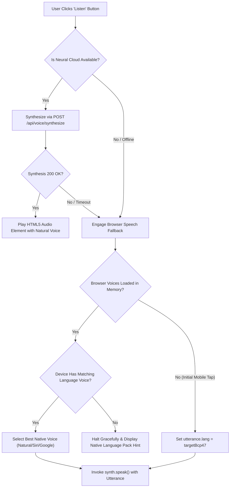

# Asteria Multilingual Voice Support & Fallback Mapping Matrix

**Task Reference:** Task 39 (Voice Playback Complete Diagnostic & Repair)  
**Supported Locales:** 8 Core Languages  
**Standard:** BCP-47 Tag Conformance & OS Voice Synthesis Resolution  
**Date:** November 2026

---

## 1. Supported Language BCP-47 Mapping

Asteria enforces strict BCP-47 compliance across both Neural Cloud engines and Browser Web Speech APIs. The table below outlines the primary locale tags, fallback language families, recommended Neural voices, and native OS speech voices:

| Locale Code | Language Name | Primary BCP-47 Tag | Fallback Language Family | Primary Google Cloud Neural Voice | Windows / Android / macOS Native Fallback Voice |
| :--- | :--- | :--- | :--- | :--- | :--- |
| **`en`** | English | `en-US` | `en` | `en-US-Journey-F` / `en-US-Neural2-F` | Samantha (macOS), Google US English (Android), Microsoft David (Windows) |
| **`hi`** | हिन्दी (Hindi) | `hi-IN` | `hi` | `hi-IN-Neural2-A` (Female) / `hi-IN-Neural2-B` (Male) | Lekha (macOS), Google हिन्दी (Android), Microsoft Kalpana / Hemant (Windows) |
| **`es`** | Español (Spanish) | `es-ES` | `es` | `es-ES-Neural2-A` / `es-ES-Neural2-B` | Monica / Jorge (macOS), Google Español (Android), Microsoft Helena (Windows) |
| **`pt`** | Português (Portuguese) | `pt-BR` | `pt` | `pt-BR-Neural2-A` / `pt-BR-Neural2-B` | Luciana (macOS), Google Português (Android), Microsoft Maria (Windows) |
| **`fr`** | Français (French) | `fr-FR` | `fr` | `fr-FR-Neural2-A` / `fr-FR-Neural2-B` | Thomas / Amelie (macOS), Google Français (Android), Microsoft Paul (Windows) |
| **`id`** | Bahasa Indonesia (Indonesian)| `id-ID` | `id` | `id-ID-Neural2-A` / `id-ID-Neural2-B` | Damayanti (macOS), Google Bahasa Indonesia (Android), Microsoft Andika (Windows) |
| **`ar`** | العربية (Arabic) | `ar-XA` | `ar` | `ar-XA-Neural2-A` / `ar-XA-Neural2-B` | Maged / Tarik (macOS), Google العربية (Android), Microsoft Naayf (Windows) |
| **`de`** | Deutsch (German) | `de-DE` | `de` | `de-DE-Neural2-A` / `de-DE-Neural2-B` | Anna / Markus (macOS), Google Deutsch (Android), Microsoft Hedda (Windows) |

---

## 2. Dynamic Fallback Chain Specification

To provide seamless, uninterrupted audio playback while ensuring linguistic fidelity:

### Strict Non-Silent Fallback Rule
**CRITICAL REQUIREMENT:** The engine will **NEVER** silently route a non-English language (e.g. Hindi or Arabic) into an English voice synthesiser. In previous iterations, if a Hindi voice was missing on a Windows or macOS machine without language pack installation, Chromium would default to reading Devanagari script through `Microsoft David (en-US)`, producing garbled, unintelligible robotic noise.

Under Asteria's repaired voice architecture:
- If a device has loaded voices and explicitly lacks matching language support, synthesis halts cleanly and triggers an informative state:
  > *"No native speech voice is available for हिन्दी on this device. Please enable Google Neural TTS or install the Hindi voice pack in your device settings."*

---

## 3. Platform Voice Compatibility

### Apple iOS Safari & macOS WebKit
- iOS ships with high-fidelity Neural Siri voices for English, Spanish, French, German, and Portuguese.
- For Hindi, Apple supplies `Lekha` (available as standard) and enhanced Siri voices downloadable under *Settings > Accessibility > Spoken Content > Voices*.
- Asteria's `getBestVoiceForLanguage()` automatically prioritizes voices containing substrings `natural`, `siri`, or `enhanced`.

### Google Android & ChromeOS
- Android devices ship with `Google Text-to-Speech Engine` pre-installed, offering full offline and network synthesis across all 8 supported languages including Hindi (`Google हिन्दी`) and Indonesian.
- Chrome on Android emits the `voiceschanged` event asynchronously upon initial user interaction. Asteria implements an exponential retry polling loop (`setInterval` over 3 seconds) to capture late-registering voices.

### Microsoft Windows Desktop (Edge / Chrome)
- Windows 10/11 includes `Microsoft Kalpana` / `Microsoft Hemant` for Hindi, `Microsoft Naayf` for Arabic, and rich Natural neural voices when running inside Microsoft Edge.

