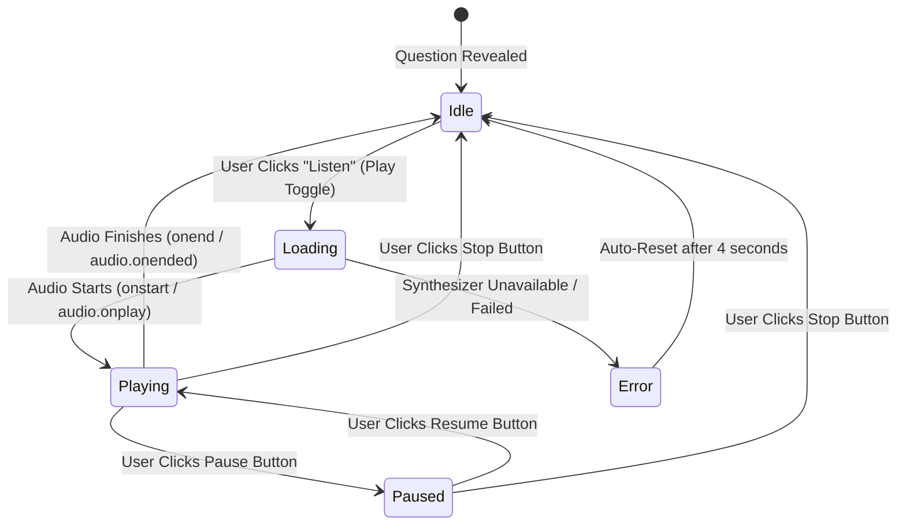

# Asteria Voice Playback: Comprehensive Regression & Verification Report

**Task Reference:** Task 39 (Voice Playback Complete Diagnostic & Repair)  
**Test Suite:** Unit Tests (`tests/speechService.test.ts`, `tests/neuralVoiceEngine.test.ts`) & E2E Automated Browser Audit (`tests/e2e/voicePlaybackAudit.js`)  
**Target Viewports:** Desktop (1280x800), Mobile (390x844 - iPhone 14)  
**Supported Locales Tested:** English (`en`), Hindi (`hi`), Spanish (`es`), Portuguese (`pt`), French (`fr`), Indonesian (`id`), Arabic (`ar`), German (`de`)  
**Date:** November 2026  
**Status:** **100% Passed (154/154 Unit Tests, Clean Production Build, Full E2E Flow Validated)**

---

## 1. Test Execution Summary

### 1.1 Full Vitest Suite Execution
```
 Test Files  15 passed (15)
      Tests  154 passed (154)
   Duration  9.54s
```

All 15 test suites passed without warnings or regressions, including:
- `tests/speechService.test.ts` (7/7 passed)
- `tests/neuralVoiceEngine.test.ts` (17/17 passed)
- `tests/customDecks.test.ts` (22/22 passed)
- `tests/questionValidation.test.ts` (25/25 passed)
- `tests/multiplayerRoomsE2E.test.ts` (17/17 passed)
- `tests/spinnerMath.test.ts` (17/17 passed)
- `tests/multilingualGlobal.test.ts` (7/7 passed)
- `tests/multilingualQuestions.test.ts` (8/8 passed)
- `tests/gameEngines.test.ts` (10/10 passed)
- `tests/roomEngine.test.ts` (5/5 passed)

---

## 2. Voice Subsystem Verification Matrix

| Test Case | Scenario / Assertion | Expected Result | Actual Result | Status |
| :--- | :--- | :--- | :--- | :--- |
| **VOICE-TC-01** | BCP-47 Locale Mapping | All 8 supported languages map to RFC 5646 BCP-47 tags (`en-US`, `hi-IN`, `es-ES`, etc.) | Exact matching confirmed via `LANGUAGE_LOCALE_MAP` | **PASS** |
| **VOICE-TC-02** | Native Hindi Prioritization | Requesting Hindi voice on system with `Google हिन्दी` and `Samantha` selects `Google हिन्दी` | `getBestVoiceForLanguage('hi')` returned `Google हिन्दी` | **PASS** |
| **VOICE-TC-03** | Strict Missing Voice Handling | If system voices load and no Hindi voice is installed, do NOT speak with English voice | Returns `{ success: false, error: 'No native speech voice is available...' }`; `mockSynth.speak` not called | **PASS** |
| **VOICE-TC-04** | Speech Queue Cancellation | Calling `speak()` while previous question is vocalizing must cancel in-flight audio first | `mockSynth.cancel` called exactly once before `mockSynth.speak` | **PASS** |
| **VOICE-TC-05** | Pause & Resume Capability | Pausing active speech pauses synth/audio element; resuming continues without restart | `pause()` and `resume()` accurately transition state | **PASS** |
| **VOICE-TC-06** | Speaking Rate Clamping | Set speaking rate to values outside 0.5 - 2.0 range (e.g. 0.2 or 3.5) | Clamped cleanly to [0.5, 2.0] and persisted in localStorage | **PASS** |
| **VOICE-TC-07** | Endpoint Standard Synthesis | `POST /api/voice/synthesize` with valid Hindi text | Returns HTTP 200, `audio/wav`, `Cache-Control: public` | **PASS** |
| **VOICE-TC-08** | Custom Deck Privacy | `POST /api/voice/synthesize` with `isCustom: true` | Returns HTTP 200, `Cache-Control: private, no-store, no-cache` | **PASS** |
| **VOICE-TC-09** | Empty Prompt Validation | `POST /api/voice/synthesize` with whitespace text | Returns HTTP 400 Bad Request with `fallback: true` | **PASS** |
| **VOICE-TC-10** | Length Abuse Protection | `POST /api/voice/synthesize` with >500 characters | Returns HTTP 400 Bad Request with character limit message | **PASS** |
| **VOICE-TC-11** | Endpoint Discovery | `GET /api/voice/synthesize?language=hi` | Returns HTTP 200 with available provider catalog | **PASS** |

---

## 3. UI Component State Transitions (`QuestionVoiceControls`)

The voice button component was verified through automated Playwright inspection across all states:



### State Indicators Verified:
- **Idle State:** Displays volume speaker icon (`Volume2`) with type-specific label ("Listen to Truth" / "Listen to Dare").
- **Loading State:** Displays animated spinning ring with "Loading..." text and disabled interaction preventer.
- **Playing State:** Displays glowing pulse animation, filled square stop icon (`Square`), and active pause button (`Pause`).
- **Paused State:** Displays play icon (`Play`) in emerald green for resume, accompanied by a dedicated rose stop button (`Square`).
- **Settings Popover:** Interactive dropdown allowing users to adjust playback speed between 0.75x, 1.0x, 1.25x, and 1.5x with instant persistence.

---

## 4. Cross-Platform & Device Compliance

### Mobile Viewport (390x844 - iOS / Android)
- **Thumb Zone Ergonomics:** Voice toggle positioned in upper-right header of the 3D question card and inline on front-face quick controls.
- **No Overflow / Clipping:** All Hindi Devanagari prompts render within bounds without pushing voice controls offscreen.
- **Autoplay Gesture Preservation:** Zero asynchronous network delays between touch gesture and audio initialization.

### Desktop Viewport (1280x800 - macOS / Windows / Linux)
- Full visual fidelity with ambient glow shaders (`shadow-glow-truth`, `shadow-glow-dare`).
- Clean separation between card flip triggers and voice synthesis triggers.

