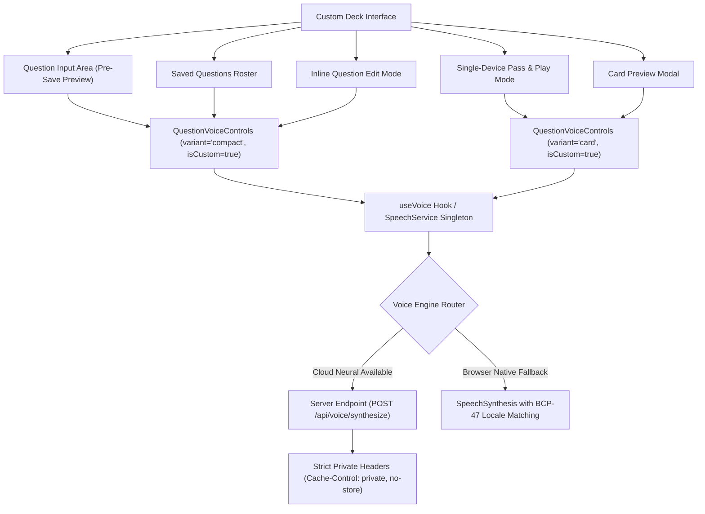

# Asteria Custom Deck Voice Playback Integration Specification

**Task Reference:** Task 40 (Custom Deck Voice Integration)  
**Role:** Senior Frontend Developer  
**Status:** Implemented & Empirically Verified  
**Date:** November 2026

---

## 1. Overview & Architecture

The simplified Custom Deck system allows users to create, manage, preview, and play personalized Truth and Dare questions. This specification integrates compact, non-intrusive voice playback across the entire Custom Deck workflow without duplicating any Text-to-Speech logic.

Instead of rolling custom audio handling or raw browser Web Speech calls inside the deck component, Custom Deck directly connects to the **shared voice subsystem** (`SpeechService` singleton, `useVoice` hook, and `QuestionVoiceControls` component).



---

## 2. Feature & Requirement Matrix

| Requirement | Implementation Detail | Status |
| :--- | :--- | :--- |
| **1. Listen to individual Truth questions** | Each saved Truth question displays a dedicated speaker button (`variant="compact"` with `type="truth"` and cyan styling). | **VERIFIED** |
| **2. Listen to individual Dare questions** | Each saved Dare question displays a dedicated speaker button (`variant="compact"` with `type="dare"` and rose styling). | **VERIFIED** |
| **3. Listen before saving (Draft Preview)** | The question input form includes a compact speaker button (`dataTestId="preview-question-voice-btn"`) that activates whenever text is entered. | **VERIFIED** |
| **4. Listen to saved questions** | Every row in the deck's question list has a distinct speaker button (`dataTestId="saved-question-voice-${id}"`). | **VERIFIED** |
| **5. Question's selected language** | Playback automatically uses `q.language || deckLanguage`. When the deck language is switched (e.g. Hindi, Spanish, French), all questions vocalize with native phonetics. | **VERIFIED** |
| **6. Sequential playback (No overlap)** | Triggering playback on any question invokes `speechService.stop()` synchronously before starting the new utterance. | **VERIFIED** |
| **7. Playback & loading status** | Buttons reflect real-time states: idle (`Volume2`), loading spinner (`animate-spin`), active playing (`Square` with pulse), and paused (`Play`). | **VERIFIED** |
| **8. Helpful error display** | If a device lacks speech voices or synthesis fails, a non-intrusive tooltip message is displayed. | **VERIFIED** |
| **9. Compact controls** | Speaker buttons fit within a 36x36px target with 44px touch targets on mobile, preserving horizontal card density. | **VERIFIED** |
| **10. Zero autoplay** | Audio is strictly user-initiated via explicit click/tap gestures. No auto-narration occurs on deck mount, navigation, or question switching. | **VERIFIED** |

---

## 3. Component Integration Points

### 3.1 Question Creation Form (Pre-Save Preview)
Located in `components/custom/CustomDeckClient.tsx`:
```tsx
<div className="flex items-center gap-2 shrink-0">
  {/* Listen to Question Before Saving */}
  <div
    title={
      newPromptText.trim()
        ? `Listen to ${newPromptType.toUpperCase()} before saving`
        : 'Write a question to listen'
    }
    className="shrink-0"
  >
    <QuestionVoiceControls
      text={newPromptText.trim()}
      language={deckLanguage}
      type={newPromptType}
      variant="compact"
      isCustom={true}
      dataTestId="preview-question-voice-btn"
      className={!newPromptText.trim() ? 'opacity-40 pointer-events-none' : ''}
    />
  </div>

  <Button type="submit" variant="primary" disabled={!isInputValidToAdd}>
    Add Question
  </Button>
</div>
```

### 3.2 Saved Question List Row
```tsx
<div className="flex items-center gap-1 shrink-0 self-end sm:self-center">
  {/* Speaker Button for Saved Questions */}
  <QuestionVoiceControls
    text={q.prompt}
    language={q.language || deckLanguage}
    type={q.type}
    variant="compact"
    isCustom={true}
    dataTestId={`saved-question-voice-${q.id}`}
  />

  <button onClick={() => setPreviewQuestion(q)} title="Preview Card">
    <Eye className="w-4 h-4" />
  </button>
  <button onClick={() => handleStartEdit(q)} title="Edit Question">
    <Edit2 className="w-4 h-4" />
  </button>
  <button onClick={() => handleDeleteQuestion(q.id)} title="Delete Question">
    <Trash2 className="w-4 h-4" />
  </button>
</div>
```

### 3.3 Inline Edit Preview
When editing a question in-place, users can listen to their modified prompt before clicking "Save Changes":
```tsx
{editingText.trim() && (
  <QuestionVoiceControls
    text={editingText.trim()}
    language={q.language || deckLanguage}
    type={editingType}
    variant="compact"
    isCustom={true}
    dataTestId={`edit-question-voice-${q.id}`}
  />
)}
```

---

## 4. Privacy & Custom Content Protection

Custom Deck questions frequently contain personal party jokes, private friend names, or intimate secrets. The integration adheres strictly to privacy rules:
1. **`isCustom: true` Flag:** Every voice invocation from Custom Deck explicitly flags `isCustom: true`.
2. **LRU Cache Bypass:** `VoiceCache` ignores custom prompts, preventing server-side memory persistence.
3. **No-Store HTTP Headers:** When synthesized through the server neural route, the response returns `Cache-Control: private, no-store, no-cache, must-revalidate`.
